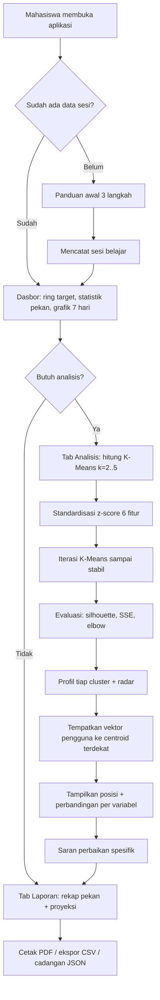
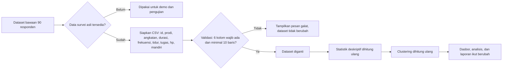
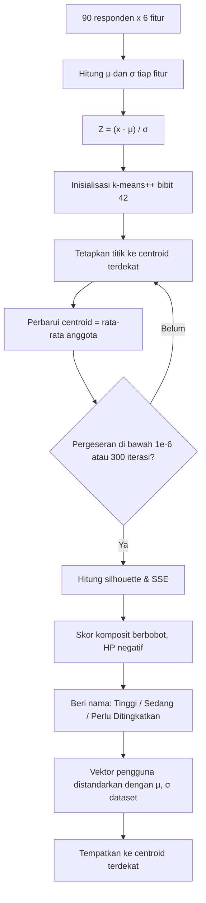

# Laporan Tahap 2 — Analisis Kebutuhan Sistem

| | |
|---|---|
| **Proyek** | StudyTrack — Aplikasi Analisis Kebiasaan Belajar Mahasiswa dengan K-Means Clustering |
| **Mata kuliah** | Rekayasa Perangkat Lunak (SSD30) |
| **Program studi** | Data Sains · Fakultas Sains dan Teknologi |
| **Institusi** | UIN K.H. Abdurrahman Wahid Pekalongan |

| | |
|---|---|
| Tahap | 2 dari 8 — Analisis Kebutuhan Sistem |
| Keluaran yang diminta | Dokumen analisis kebutuhan sistem |
| Status | Selesai |
| Dasar | [Tahap 1 — Identifikasi Masalah](tahap-1-identifikasi-masalah.md) |

---

## 1. Deskripsi Sistem

**StudyTrack** adalah aplikasi web yang membantu mahasiswa mencatat sesi belajar harian, mengubah catatan tersebut menjadi enam variabel kebiasaan, lalu mengelompokkan polanya dengan **K-Means clustering** untuk menentukan posisi pengguna di antara responden lain.

Sistem berjalan sepenuhnya di sisi peramban: tidak ada server aplikasi dan tidak ada basis data terpusat pada versi ini. Data disimpan di `localStorage` peramban, sedangkan dataset responden yang menjadi dasar clustering dibangkitkan dari berkas `dataset.js` dan dapat diganti lewat impor CSV.

**Batasan sistem yang disepakati:**

| Aspek | Keputusan | Alasan |
|-------|-----------|--------|
| Pengguna | Satu pengguna per peramban | Menghindari kebutuhan autentikasi pada tahap ini |
| Penyimpanan | `localStorage` | Aplikasi dapat dijalankan tanpa server, termasuk dari `file://` |
| Dataset | 90 responden sintetis, dapat diganti CSV | Memungkinkan pengujian menyeluruh sebelum survei asli terkumpul |
| Metode | K-Means, implementasi sendiri | Transparan, dapat diuji unit, dan tidak menambah dependensi |
| Cakupan hasil | Pengelompokan kebiasaan, bukan prediksi nilai | Sesuai rumusan masalah Tahap 1 |

---

## 2. Identifikasi Aktor

| Aktor | Jenis | Deskripsi | Hak/interaksi utama |
|-------|-------|-----------|---------------------|
| **Mahasiswa** | Aktor utama | Pengguna yang mencatat sesi belajar dan membaca hasil analisis | Seluruh FR kecuali pengelolaan dataset lanjutan |
| **Pembimbing Akademik** | Aktor sekunder | Membaca ringkasan kebiasaan dan mencetak laporan | FR-03, FR-08 (baca & cetak) |
| **Pengelola Data** | Aktor sekunder | Menyiapkan dataset survei yang menjadi dasar clustering | FR-07 (impor/ekspor/bersihkan dataset) |

**Catatan:** pada versi web ini ketiga peran memakai antarmuka yang sama tanpa pemisahan hak akses. Pemisahan peran (login, peran dosen read-only) direncanakan pada Tahap 5 versi final bersama basis data terpusat. Aktor "sistem" seperti *service worker* dan mesin K-Means tidak dihitung sebagai aktor karena tidak memiliki tujuan sendiri.

### 2.1 Keterkaitan aktor dengan masalah

| Aktor | Masalah yang diselesaikan | Kebutuhan pokok |
|-------|---------------------------|-----------------|
| Mahasiswa | P-01, P-02, P-03, P-05 | Mencatat cepat, melihat posisi, mendapat saran spesifik |
| Pembimbing | P-04 | Melihat kondisi lebih awal, laporan yang bisa dicetak |
| Pengelola data | P-03 | Mengganti dataset sintetis dengan hasil survei asli |

---

## 3. Kebutuhan Fungsional (FR)

Sebelas kebutuhan fungsional berikut disusun dari rumusan masalah Tahap 1. Setiap FR memiliki satu penanggung jawab pada pembagian tugas (lihat `README.md`).

### FR-01 — Mencatat sesi belajar

| Atribut | Keterangan |
|---------|-----------|
| Aktor | Mahasiswa |
| Prioritas | **Must** |
| Masalah yang diselesaikan | P-01 |

**Deskripsi.** Pengguna mencatat satu sesi belajar dengan mengisi tanggal, mata kuliah, jenis sesi (mandiri/kelompok/kelas), durasi dalam menit, tingkat fokus 1–5, menit bermain HP saat belajar, jumlah tugas yang selesai, jam tidur malam sebelumnya, dan catatan opsional.

**Kriteria penerimaan:**

- Formulir dapat disimpan dengan hanya mengisi tanggal dan durasi; kolom lain memiliki nilai bawaan yang masuk akal.
- Durasi dibatasi 5–720 menit, fokus 1–5, jam tidur 0–14.
- Tersedia tombol durasi cepat (30/45/60/90 menit) untuk mempercepat pengisian.
- Setelah disimpan, sesi langsung muncul di riwayat dan statistik dasbor ikut berubah.
- Bila penyimpanan peramban penuh, muncul pemberitahuan dan data tidak hilang diam-diam.

### FR-02 — Mengelola riwayat sesi

| Atribut | Keterangan |
|---------|-----------|
| Aktor | Mahasiswa |
| Prioritas | **Must** |
| Masalah yang diselesaikan | P-01 |

**Deskripsi.** Pengguna melihat riwayat sesi yang dikelompokkan per tanggal, menyaringnya menurut rentang waktu, menyunting, menghapus, atau mengulang sesi lama untuk hari ini.

**Kriteria penerimaan:**

- Filter tersedia untuk 7 hari, 30 hari, dan semua waktu.
- Riwayat dikelompokkan per tanggal dengan total sesi dan total durasi tiap hari.
- Setiap butir menampilkan durasi, fokus, menit HP, jumlah tugas, dan jam tidur.
- Aksi hapus meminta konfirmasi bila menyangkut seluruh riwayat.
- Sesi yang diulang tercatat pada tanggal hari ini dengan pengenal baru.

### FR-03 — Dasbor ringkasan

| Atribut | Keterangan |
|---------|-----------|
| Aktor | Mahasiswa, Pembimbing |
| Prioritas | **Must** |
| Masalah yang diselesaikan | P-02, P-05 |

**Deskripsi.** Halaman utama menampilkan ring progres target harian, empat statistik pekan (jam belajar, jumlah sesi, hari aktif, rata-rata fokus), grafik menit belajar tujuh hari terakhir, mata kuliah dengan durasi terbanyak, dan posisi cluster pengguna.

**Kriteria penerimaan:**

- Ring progres menunjukkan persentase pencapaian target harian yang dapat diatur.
- Keempat statistik berubah sesuai rentang 7 hari terakhir.
- Grafik batang menampilkan tujuh hari dengan hari ini dibedakan warnanya.
- Bila belum ada data, tampil keadaan kosong dengan ajakan mencatat atau mengisi data contoh.
- Posisi cluster ditampilkan beserta jarak ke centroid.

### FR-04 — Menjalankan analisis K-Means

| Atribut | Keterangan |
|---------|-----------|
| Aktor | Mahasiswa |
| Prioritas | **Must** |
| Masalah yang diselesaikan | P-03 |

**Deskripsi.** Sistem menjalankan K-Means atas dataset responden dengan jumlah cluster yang dapat dipilih (k = 2..5), lalu menampilkan hasil evaluasinya.

**Kriteria penerimaan:**

- Enam fitur distandarkan *z-score* sebelum clustering.
- Inisialisasi memakai *k-means++* dengan bibit tetap sehingga hasil dapat diulang persis.
- Iterasi berhenti saat pergeseran centroid < 1e-6 atau mencapai 300 iterasi.
- Cluster kosong ditangani dengan memindahkan centroid ke titik terjauh.
- Ditampilkan: jumlah cluster, silhouette score, jumlah iterasi, dan SSE.
- Mengganti nilai k langsung menghitung ulang seluruh tampilan analisis.
- Waktu hitung di bawah 100 ms untuk 90 responden.

### FR-05 — Memvisualisasikan hasil clustering

| Atribut | Keterangan |
|---------|-----------|
| Aktor | Mahasiswa, Pembimbing |
| Prioritas | **Must** |
| Masalah yang diselesaikan | P-02, P-03 |

**Deskripsi.** Hasil clustering disajikan sebagai scatter plot, radar perbandingan profil, batang profil tiap cluster, dan grafik elbow untuk pemilihan k.

**Kriteria penerimaan:**

- Scatter menampilkan seluruh responden, warna mengikuti cluster, dengan legenda.
- Radar membandingkan seluruh cluster pada enam fitur.
- Batang profil menampilkan nilai rata-rata tiap fitur per cluster.
- Grafik elbow menampilkan SSE terhadap k = 1..6.
- Semua grafik diberi judul sumbu dan keterangan satuan.

### FR-06 — Menempatkan posisi pengguna

| Atribut | Keterangan |
|---------|-----------|
| Aktor | Mahasiswa |
| Prioritas | **Must** |
| Masalah yang diselesaikan | P-03, P-05 |

**Deskripsi.** Vektor enam fitur pengguna dari tujuh hari terakhir distandarkan memakai μ dan σ dataset, lalu ditempatkan ke centroid terdekat. Sistem menampilkan nama cluster, jarak ke centroid, dan perbandingan tiap variabel terhadap rata-rata kelompok.

**Kriteria penerimaan:**

- Posisi dihitung ulang setiap kali data sesi berubah.
- Setiap variabel menampilkan nilai pengguna, nilai rata-rata kelompok, dan selisih bertanda.
- Selisih positif/negatif diberi warna berbeda dan dijelaskan artinya (ingat: HP adalah fitur negatif).
- Bila belum ada sesi dalam 7 hari, tampil pesan bahwa posisi belum dapat ditentukan.

### FR-07 — Mengelola dataset responden

| Atribut | Keterangan |
|---------|-----------|
| Aktor | Pengelola Data |
| Prioritas | **Must** |
| Masalah yang diselesaikan | P-03 |

**Deskripsi.** Pengguna melihat tabel responden, mencari berdasarkan ID/prodi, menyaring menurut program studi, mengurutkan kolom, menghapus baris, mengimpor CSV hasil survei, mengekspor CSV, dan mengembalikan dataset ke data bawaan.

**Kriteria penerimaan:**

- Tabel menampilkan ID, prodi, angkatan, dan enam fitur.
- Pencarian dan filter dapat dipakai bersamaan.
- Klik judul kolom mengurutkan naik/turun dengan penanda arah.
- Impor CSV memvalidasi keberadaan enam kolom wajib dan menolak data dengan kurang dari 10 baris.
- Pesan galat impor menyebutkan kolom apa yang tidak ditemukan.
- Tersedia statistik deskriptif (rata-rata, simpangan baku, min, maks) untuk tiap fitur.

### FR-08 — Laporan dan ekspor

| Atribut | Keterangan |
|---------|-----------|
| Aktor | Mahasiswa, Pembimbing |
| Prioritas | **Should** |
| Masalah yang diselesaikan | P-04 |

**Deskripsi.** Menyusun rekap pekan, proyeksi pekan berikutnya dengan regresi linear, ringkasan hasil cluster, serta menyediakan cetak/PDF dan ekspor CSV/JSON.

**Kriteria penerimaan:**

- Rekap menampilkan total durasi, jumlah sesi, hari aktif, dan konsistensi.
- Proyeksi memakai regresi kuadrat terkecil atas empat pekan terakhir dan menampilkan R².
- Tabel rekap harian memuat tanggal, jumlah sesi, durasi, dan tugas.
- Tombol cetak menghasilkan halaman cetak tanpa latar kota, tab bar, dan tombol aksi.
- Ekspor CSV sesi, CSV dataset, dan cadangan JSON dapat diunduh.

### FR-09 — Pengaturan aplikasi

| Atribut | Keterangan |
|---------|-----------|
| Aktor | Mahasiswa |
| Prioritas | **Should** |
| Masalah yang diselesaikan | P-05 |

**Deskripsi.** Pengguna mengubah nama panggilan, target harian, jumlah cluster bawaan, dan tema; serta menghapus seluruh riwayat sesi.

**Kriteria penerimaan:**

- Target harian dibatasi 15–600 menit.
- Perubahan tersimpan dan langsung berlaku tanpa memuat ulang halaman.
- Menghapus seluruh riwayat meminta konfirmasi lebih dulu.

### FR-10 — Panduan awal (onboarding)

| Atribut | Keterangan |
|---------|-----------|
| Aktor | Mahasiswa |
| Prioritas | **Could** |
| Masalah yang diselesaikan | P-02 |

**Deskripsi.** Saat aplikasi pertama kali dibuka, muncul tur tiga langkah yang menjelaskan cara mencatat, cara kerja K-Means, dan bentuk saran yang diberikan. Tur dapat dilewati.

**Kriteria penerimaan:**

- Tur hanya muncul bila pengguna belum pernah menyelesaikannya.
- Terdapat penanda langkah dan tombol Lewati.
- Status "sudah melihat tur" tersimpan sehingga tidak muncul lagi.

### FR-11 — Saran kontekstual

| Atribut | Keterangan |
|---------|-----------|
| Aktor | Mahasiswa |
| Prioritas | **Could** |
| Masalah yang diselesaikan | P-05 |

**Deskripsi.** Berdasarkan kondisi terkini (runtutan hari mencatat, jam tidur, penggunaan HP, dan posisi cluster), sistem menampilkan satu saran yang paling relevan pada kartu "Catatan Nora".

**Kriteria penerimaan:**

- Aturan dievaluasi berurutan; saran yang tampil hanya satu.
- Saran menyebut angka nyata dari data pengguna, bukan kalimat umum.
- Bila belum ada data, yang tampil adalah ajakan mencatat sesi pertama.

### Ringkasan FR

| Kode | Nama | Aktor utama | Prioritas | Status implementasi |
|------|------|-------------|-----------|---------------------|
| FR-01 | Mencatat sesi belajar | Mahasiswa | Must | Selesai |
| FR-02 | Mengelola riwayat sesi | Mahasiswa | Must | Selesai |
| FR-03 | Dasbor ringkasan | Mahasiswa | Must | Selesai |
| FR-04 | Menjalankan analisis K-Means | Mahasiswa | Must | Selesai |
| FR-05 | Visualisasi hasil clustering | Mahasiswa | Must | Selesai |
| FR-06 | Penempatan posisi pengguna | Mahasiswa | Must | Selesai |
| FR-07 | Pengelolaan dataset responden | Pengelola data | Must | Selesai |
| FR-08 | Laporan dan ekspor | Mahasiswa, Pembimbing | Should | Selesai |
| FR-09 | Pengaturan aplikasi | Mahasiswa | Should | Selesai |
| FR-10 | Panduan awal | Mahasiswa | Could | Selesai |
| FR-11 | Saran kontekstual | Mahasiswa | Could | Selesai |

### Penanggung jawab kebutuhan fungsional

Pembagian mengikuti **batas modul**, bukan batas penulisan laporan, agar kontribusi setiap anggota
dapat ditelusuri lewat riwayat commit repositori kode.

| Anggota | Nama | NIM | FR | Modul utama | Diagram |
|:-------:|------|-----|----|-------------|---------|
| 1 | Yuniar Zahra Wiyani | 60124004 | FR-01, FR-02 | `vJurnal`, `formSesi`, `csvSesi` | 1 Activity + 1 Sequence |
| 2 | Aninda Rizqi Amelia | 60124009 | FR-03, FR-08 | `vDasbor`, `vLaporan` | 1 Activity + 1 Sequence |
| 3 | Maheswari Pasa Putri Syamsudar | 60124010 | FR-04, FR-05 | `kmeans.js`, `vAnalisis`, `grafik.js` | 1 Activity + 1 Sequence |
| 4 | Hasan | 60124013 | FR-06, FR-07 | `tempatkan`, `vDataset` | 1 Activity + 1 Sequence |
| 5 | Sifa Sabrina | 60124023 | FR-09, FR-10, FR-11 | `bukaAtur`, `bukaKenalan`, `wawasan` | 1 Activity + 1 Sequence |

Setiap anggota memegang minimal satu FR dan minimal satu Activity Diagram serta satu Sequence
Diagram, sesuai ketentuan spesifikasi bagian 3 dan 8. Use Case Diagram dan Class Diagram dikerjakan
kolaboratif pada Tahap 3.

Selain kesebelas FR di atas, sistem juga memiliki **kebutuhan teknis pendukung** yang tidak dihitung sebagai FR karena tidak menambah kemampuan bisnis: tema gelap/terang, animasi antarmuka, dan mode luring (service worker). Ketiganya dibahas pada NFR.

---

## 4. Kebutuhan Nonfungsional (NFR)

Setiap NFR diberi tolok ukur yang dapat diperiksa, bukan pernyataan sifat.

| Kode | Kategori | Kebutuhan | Tolok ukur | Cara verifikasi |
|------|----------|-----------|------------|-----------------|
| NFR-01 | Kinerja | Analisis clustering berjalan cepat | ≤ 100 ms untuk 90 responden, k = 3 | Diukur: **10,15 ms** rata-rata (20 pengulangan, Node.js) |
| NFR-02 | Kinerja | Waktu muat awal ringan | ≤ 200 KB aset tanpa kompresi | Diukur: **148 KB** (HTML + CSS + 7 berkas JS) |
| NFR-03 | Ukuran | Basis kode terkelola | ≤ 5.000 baris | Diukur: **3.061 baris** (HTML + CSS + JS) |
| NFR-04 | Keandalan | Hasil clustering dapat diulang | Bibit tetap → label & SSE identik pada dua kali jalan | Uji unit "determinisme" |
| NFR-05 | Keandalan | Data tidak hilang saat penyimpanan gagal | Ada penanganan `QuotaExceededError` dengan pemberitahuan | Uji manual (isi localStorage hingga penuh) |
| NFR-06 | Privasi | Data pengguna tidak keluar dari peramban | Tidak ada permintaan jaringan selain aset statis | Pemeriksaan tab Network |
| NFR-07 | Portabilitas | Dapat dijalankan tanpa server | Semua fitur berfungsi dari `file://` | Uji buka `index.html` langsung |
| NFR-08 | Portabilitas | Tidak ada dependensi pihak ketiga | Tidak ada framework, tidak ada CDN | Pemeriksaan `package.json` (tidak ada) & `<script src>` |
| NFR-09 | Ketersediaan | Dapat dipakai luring setelah kunjungan pertama | Aset ter-cache oleh service worker | Uji mode offline |
| NFR-10 | Kegunaan | Antarmuka rapi di layar kecil | 360–1440 px tanpa gulir horizontal | Tangkapan layar 400 px & 1280 px |
| NFR-11 | Kegunaan | Pencatatan sesi cepat | Selesai < 30 detik dengan nilai bawaan | Uji waktu henti (stopwatch) |
| NFR-12 | Aksesibilitas | Menghormati preferensi gerak pengguna | `prefers-reduced-motion` mematikan animasi & latar kota | Uji emulasi media |
| NFR-13 | Aksesibilitas | Kontrol memiliki label | Setiap tombol ikon punya `aria-label`; grafik punya `role="img"` | Pemeriksaan DOM |
| NFR-14 | Pemeliharaan | Logika Data Sains terpisah dari antarmuka | `kmeans.js` tidak menyentuh DOM; dapat di-`require` Node | Uji unit berjalan tanpa peramban |
| NFR-15 | Pemeliharaan | Ada uji otomatis | ≥ 8 uji unit lulus | `node --test tests/kmeans.test.mjs` |
| NFR-16 | Kompatibilitas | Berjalan di peramban modern | Chrome, Edge, Firefox, Safari versi terkini | Uji manual lintas peramban |
| NFR-17 | Kualitas hasil | Cluster terpisah dengan baik | Silhouette > 0,25 | Diukur: **0,355** pada dataset bawaan |

---

## 5. Proses Bisnis Sistem

### 5.1 Alur utama

### 5.2 Alur pengelolaan dataset

### 5.3 Siklus hidup satu sesi belajar

| Status | Pemicu | Yang terjadi |
|--------|--------|--------------|
| Dicatat | Pengguna mengirim formulir | Sesi masuk `state.sesi`, tersimpan ke `localStorage` |
| Aktif di statistik | Tanggal masuk rentang 7/30 hari | Ikut dihitung pada dasbor, riwayat, dan vektor fitur |
| Disunting | Pengguna menekan ikon pensil | Formulir terisi nilai lama, disimpan sebagai pembaruan |
| Diulang | Pengguna menekan ikon ulang | Salinan baru dengan tanggal hari ini dan ID baru |
| Dihapus | Pengguna menekan ikon hapus | Sesi keluar dari state, statistik dihitung ulang |

### 5.4 Alur komponen Data Sains

---

## 6. Kebutuhan Data

### 6.1 Entitas dan atribut

**Entitas 1 — Sesi belajar** (dibuat oleh pengguna, disimpan di `localStorage`)

| Atribut | Tipe | Wajib | Aturan |
|---------|------|-------|--------|
| `id` | string | ya | Dibuat otomatis, unik |
| `tanggal` | date (YYYY-MM-DD) | ya | Tidak boleh kosong |
| `matkul` | string | tidak | Bila kosong ditampilkan "Sesi belajar" |
| `jenis` | enum | ya | `mandiri` / `kelompok` / `kelas`, bawaan `mandiri` |
| `menit` | integer | ya | 5–720 |
| `fokus` | integer | ya | 1–5, bawaan 4 |
| `hpMenit` | integer | ya | 0–600, bawaan 20 |
| `tugas` | integer | ya | 0–30, bawaan 1 |
| `tidur` | decimal | ya | 0–14, bawaan 7 |
| `catatan` | string | tidak | Bebas |
| `dibuat` | timestamp | ya | Milidetik, untuk pengurutan |

**Entitas 2 — Responden survei** (dataset dasar clustering)

| Atribut | Tipe | Wajib | Aturan |
|---------|------|-------|--------|
| `id` | string | ya | Unik, mis. `R01` |
| `prodi` | string | ya | Dipakai untuk filter |
| `angkatan` | integer | ya | Tahun masuk |
| `durasi` | decimal | ya | Jam belajar per hari |
| `frekuensi` | integer | ya | Hari belajar per minggu, 0–7 |
| `tidur` | decimal | ya | Jam tidur per hari |
| `tugas` | integer | ya | Tugas selesai per minggu |
| `hp` | decimal | ya | Jam main HP saat belajar per hari |
| `mandiri` | integer | ya | Sesi belajar mandiri per minggu |

### 6.2 Definisi fitur dan arah pengaruhnya

| Fitur | Kunci | Satuan | Arah | Bobot skor komposit |
|-------|-------|--------|------|---------------------|
| Durasi belajar | `durasi` | jam/hari | makin tinggi makin baik | 0,28 |
| Frekuensi belajar | `frekuensi` | hari/minggu | makin tinggi makin baik | 0,20 |
| Durasi tidur | `tidur` | jam/hari | makin tinggi makin baik | 0,14 |
| Tugas selesai | `tugas` | tugas/minggu | makin tinggi makin baik | 0,18 |
| Penggunaan HP saat belajar | `hp` | jam/hari | makin tinggi makin **buruk** | −0,16 |
| Belajar mandiri | `mandiri` | sesi/minggu | makin tinggi makin baik | 0,16 |

Bobot dipakai **hanya untuk memberi peringkat dan nama cluster**, bukan untuk proses clustering itu sendiri. K-Means memperlakukan keenam fitur setara setelah standardisasi.

### 6.3 Sumber dan volume data

| Aspek | Keterangan |
|-------|-----------|
| Sumber saat ini | Sintetis — tiga arketipe kebiasaan (tinggi/sedang/rendah) × 30 responden + derau normal |
| Berkas | `data/survei.csv` dan `assets/js/dataset.js` |
| Pembangkit | `tools/buat-dataset.mjs`, bibit tetap 20261121 |
| Volume | 90 baris × 9 kolom |
| Jumlah minimum | 10 baris (divalidasi saat impor) agar clustering bermakna |
| Rencana penggantian | Kuesioner Google Forms dengan pertanyaan sesuai enam variabel |
| Alasan sintetis | Agar sistem dapat diuji menyeluruh sebelum survei lapangan terkumpul |

### 6.4 Aturan kualitas data

- Tidak ada nilai negatif pada keenam fitur.
- `frekuensi` tidak melebihi 7 (jumlah hari dalam sepekan).
- Nilai kosong saat impor diperlakukan sebagai 0 dan dicatat sebagai peringatan.
- Baris dengan ID ganda ditolak.
- Standardisasi menggunakan μ dan σ **dataset**, bukan μ dan σ pengguna, agar posisi pengguna sebanding dengan responden.

### 6.5 Kebutuhan penyimpanan

| Data | Tempat | Perkiraan ukuran |
|------|--------|------------------|
| Sesi belajar | `localStorage`, kunci `studytrack_v1` | ± 200 byte per sesi; 1 tahun (± 700 sesi) ≈ 140 KB |
| Dataset responden | `localStorage` setelah impor | ± 90 byte per baris; 1.000 baris ≈ 90 KB |
| Pengaturan | `localStorage`, satu objek | < 200 byte |

Batas `localStorage` umumnya 5 MB per origin, sehingga kapasitas masih jauh mencukupi untuk pemakaian satu semester.

---

## 7. Prioritas Kebutuhan

Prioritas memakai kerangka **MoSCoW** dengan pertimbangan: (a) apakah FR diperlukan agar komponen Data Sains dapat berjalan, dan (b) apakah FR langsung menjawab salah satu masalah P-01..P-05.

| Prioritas | FR | Alasan |
|-----------|-----|--------|
| **Must** | FR-01, FR-02, FR-04, FR-06, FR-07 | Tanpa pencatatan tidak ada data; tanpa dataset tidak ada pembanding; tanpa penempatan tidak ada jawaban atas P-03. FR-02 masuk Must karena tanpa penyuntingan, satu salah input merusak seluruh analisis |
| **Must** | FR-03, FR-05 | Hasil analisis harus disajikan agar berguna; FR-05 adalah bentuk penyajian komponen Data Sains |
| **Should** | FR-08, FR-09 | Laporan dibutuhkan untuk pengumpulan tugas dan pemakaian pembimbing; pengaturan membuat aplikasi dapat disesuaikan, tetapi aplikasi tetap berfungsi tanpanya |
| **Could** | FR-10, FR-11 | Menambah kepuasan dan kejelasan, tidak memengaruhi kebenaran hasil |
| **Won't (versi ini)** | Login multi-pengguna, sinkronisasi server, notifikasi otomatis, integrasi SIAKAD | Menambah kompleksitas besar tanpa mengubah inti solusi; dijadwalkan pada versi final |

### 7.1 Definisi MVP

Versi minimum yang sudah dianggap menyelesaikan masalah:

> Pengguna dapat mencatat sesi (FR-01), melihat riwayat (FR-02), menjalankan K-Means atas dataset (FR-04, FR-07), melihat visualisasinya (FR-05), dan mengetahui posisinya beserta perbandingan variabel (FR-03, FR-06).

Ketujuh FR Must tersebut sudah terimplementasi seluruhnya pada versi web saat ini.

---

## 8. Matriks Keterlacakan

Menghubungkan masalah → kebutuhan → modul kode → pengujian.

| Masalah | FR | Modul utama | Bukti uji |
|---------|-----|-------------|-----------|
| P-01 | FR-01, FR-02 | `app.js` (`vJurnal`, `formSesi`, `csvSesi`) | Uji interaksi simpan sesi; uji manual sunting/hapus/ulang |
| P-02 | FR-03, FR-05, FR-10 | `app.js` (`vDasbor`), `grafik.js`, `animasi.js` | Uji manual dasbor; tangkapan layar 5 tab |
| P-03 | FR-04, FR-06, FR-07 | `kmeans.js`, `app.js` (`vAnalisis`, `vDataset`) | Uji unit K-Means, determinisme, silhouette, penempatan |
| P-04 | FR-08 | `app.js` (`vLaporan`), `kmeans.js` (`regresi`) | Uji unit regresi; uji manual cetak & ekspor |
| P-05 | FR-06, FR-09, FR-11 | `app.js` (`perbandingan`, `wawasan`) | Uji manual perbandingan variabel & saran |

### 8.1 Keterkaitan dengan komponen Data Sains

| Kebutuhan | Ketergantungan pada `kmeans.js` |
|-----------|--------------------------------|
| FR-04 | `standardisasi`, `kmeans`, `silhouette`, `elbow` |
| FR-05 | Hasil FR-04 (`model.label`, `profil`) |
| FR-06 | `tempatkan` + μ dan σ dataset |
| FR-07 | `statistik` untuk tabel deskriptif |
| FR-08 | `regresi` untuk proyeksi pekan |

---

## 9. Kebutuhan Antarmuka (ringkas)

Rincian perancangan antarmuka masuk Tahap 4; pada tahap ini hanya ditetapkan kebutuhan tingkat tinggi.

| Halaman | Isi pokok | Aktor |
|---------|-----------|-------|
| Dasbor | Ring target, 4 statistik, grafik 7 hari, posisi cluster | Mahasiswa |
| Jurnal | Formulir sesi + riwayat per tanggal | Mahasiswa |
| Analisis | Metode, statistik cluster, scatter, profil, radar, elbow | Mahasiswa |
| Dataset | Tabel responden, pencarian, filter, impor/ekspor | Pengelola data |
| Laporan | Rekap pekan, proyeksi, ringkasan cluster, ekspor | Mahasiswa, Pembimbing |

**Ketentuan lintas halaman:** navigasi tab di bawah pada layar kecil, di dalam satu kolom maksimum 860 px pada layar lebar; semua grafik berupa SVG yang ikut menyesuaikan lebar.

---

## 10. Kesimpulan Tahap 2

Analisis kebutuhan menghasilkan **11 kebutuhan fungsional** dan **17 kebutuhan nonfungsional** yang seluruhnya memiliki tolok ukur terukur. Tujuh FR berprioritas Must membentuk MVP yang sudah terimplementasi, sehingga proyek dapat dilanjutkan ke Tahap 3 (perancangan UML) dengan dasar yang tetap.

Tiga keputusan yang perlu dijaga konsistensinya pada tahap berikutnya:

1. **Enam fitur tidak berubah** — diagram UML, basis data, dan antarmuka harus mengacu pada keenam variabel yang sama.
2. **Pemisahan mesin dan antarmuka** — `kmeans.js` tetap bebas DOM agar dapat diuji dan dipindahkan ke backend pada versi final.
3. **Dataset dapat diganti** — perancangan basis data harus memungkinkan penggantian 90 responden sintetis dengan hasil survei asli tanpa mengubah skema.

---

### Keluaran tahap ini

- [x] Identifikasi aktor atau pengguna sistem
- [x] Kebutuhan fungsional (FR-01 … FR-11) beserta kriteria penerimaan
- [x] Kebutuhan nonfungsional (NFR-01 … NFR-17) beserta tolok ukur
- [x] Proses bisnis sistem (4 alur)
- [x] Kebutuhan data atau dataset
- [x] Prioritas kebutuhan (MoSCoW) dan definisi MVP
- [x] Matriks keterlacakan masalah → FR → modul → uji

**Tahap sebelumnya:** [Tahap 1 — Identifikasi Masalah](tahap-1-identifikasi-masalah.md)
**Tahap berikutnya:** Tahap 3 — Perancangan Sistem (UML) — *belum dikerjakan*
