# LAPORAN TAHAP 3 — PERANCANGAN SISTEM (UML)

| | |
|---|---|
| **Proyek** | StudyTrack — Aplikasi Analisis Kebiasaan Belajar Mahasiswa dengan K-Means Clustering |
| **Mata kuliah** | Rekayasa Perangkat Lunak (SSD30) |
| **Program studi** | Data Sains · Fakultas Sains dan Teknologi |
| **Institusi** | UIN K.H. Abdurrahman Wahid Pekalongan |
| **Tahap** | 3 dari 8 — Perancangan Sistem (UML) |
| **Versi dokumen** | v1.0 · 27 November 2026 |

---

## 1. Ruang lingkup perancangan

Dokumen ini menerjemahkan kebutuhan pada [Tahap 2](tahap-2-analisis-kebutuhan.md) menjadi rancangan
berorientasi objek. Seluruh diagram diturunkan dari **11 kebutuhan fungsional (FR-01…FR-11)** yang sudah
disepakati, bukan dari fitur yang kebetulan ada di kode. Arah penurunannya satu arah:

```
FR-01…FR-11  →  Use Case  →  Activity Diagram  →  Sequence Diagram  →  Class Diagram
```

Empat jenis diagram wajib dipenuhi sesuai spesifikasi bagian 7 (Tahap 3):

| No | Diagram | Jumlah | Sifat | Penanggung jawab |
|:--:|---------|:------:|-------|------------------|
| 1 | Use Case Diagram | 1 | kolaboratif | seluruh anggota |
| 2 | Activity Diagram | 5 | per anggota | masing-masing anggota |
| 3 | Sequence Diagram | 5 | per anggota | masing-masing anggota |
| 4 | Class Diagram | 1 | kolaboratif | seluruh anggota |

Pembagian Activity dan Sequence Diagram mengikuti **pembagian FR yang sudah ditetapkan pada Tahap 2**,
sehingga setiap anggota memegang diagram untuk fitur yang juga ia implementasikan. Ini memenuhi ketentuan
spesifikasi bagian 3 butir 4 dan bagian 8: pengerjaan tidak dipisahkan antara "yang menggambar" dan
"yang memprogram".

| Anggota | NIM | FR | Activity | Sequence |
|:-------:|-----|----|----------|----------|
| Yuniar Zahra Wiyani | 60124004 | FR-01, FR-02 | AD-01 | SD-01 |
| Aninda Rizqi Amelia | 60124009 | FR-03, FR-08 | AD-02 | SD-02 |
| Maheswari Pasa Putri Syamsudar | 60124010 | FR-04, FR-05 | AD-03 | SD-03 |
| Hasan | 60124013 | FR-06, FR-07 | AD-04 | SD-04 |
| Sifa Sabrina | 60124023 | FR-09, FR-10, FR-11 | AD-05 | SD-05 |

---

## 2. Use Case Diagram

### 2.1 Diagram

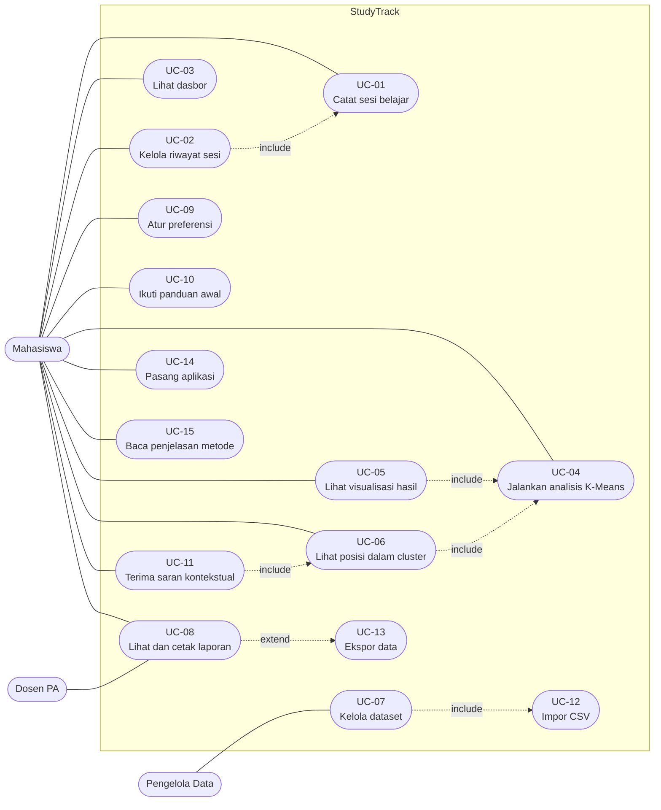

### 2.2 Penjelasan

**Tujuan.** Memetakan batas sistem (*system boundary*) StudyTrack dan seluruh fungsi utama yang dilihat
dari sisi pengguna. Diagram ini menjadi acuan tunggal: setiap use case di dalam kotak harus dapat
ditunjuk implementasinya di kode, dan setiap fungsi di kode harus punya use case.

**Aktor.** Ada tiga aktor dengan hak berbeda:

- **Mahasiswa** — aktor utama. Seluruh use case pencatatan, analisis, dan pelaporan berpusat padanya.
  Dialah pemilik data sesi belajar, sehingga data yang dianalisis adalah data miliknya sendiri.
- **Dosen PA** — aktor pendukung yang hanya membaca (UC-08). Pada versi web saat ini peran ini belum
  dipisahkan secara teknis; lihat catatan keterbatasan di bagian 6.
- **Pengelola Data** — aktor yang bertanggung jawab atas dataset responden (UC-07). Pada praktiknya
  orang ini bisa mahasiswa yang sama, tetapi tanggung jawabnya berbeda: ia mengurus *data acuan*,
  bukan *data pribadi*.

**Relasi antar use case.**

| Relasi | Arti | Alasan |
|--------|------|--------|
| UC-02 **include** UC-01 | Menambah sesi selalu menjadi bagian dari mengelola riwayat | Riwayat tidak mungkin dikelola bila belum ada sesi yang dicatat |
| UC-05 **include** UC-04 | Visualisasi hanya bermakna setelah model dijalankan | Grafik memakai keluaran `analisis()` |
| UC-06 **include** UC-04 | Penempatan posisi memerlukan centroid | `tempatkan()` butuh model hasil `kmeans()` |
| UC-07 **include** UC-12 | Impor CSV adalah salah satu cara mengisi dataset | Impor tidak berdiri sendiri sebagai fitur |
| UC-08 **extend** UC-13 | Ekspor memperluas laporan, tidak wajib | Laporan tetap sah tanpa diekspor |
| UC-11 **include** UC-06 | Saran butuh tahu posisi pengguna di cluster | Tanpa posisi, saran tidak kontekstual |

**Yang sengaja tidak dijadikan use case.** Tema gelap/terang, animasi, dan mode luring (PWA) tidak
dimunculkan sebagai use case karena tidak menambah kemampuan bisnis — ketiganya sudah dibahas sebagai
NFR pada Tahap 2. Memasukkannya justru mengaburkan fokus: diagram use case harus menjawab "apa yang
bisa dilakukan pengguna untuk menyelesaikan masalahnya", bukan "apa saja yang bisa diklik".

---

## 3. Activity Diagram

Lima diagram berikut masing-masing mewakili satu anggota. Semuanya memakai notasi yang sama: bulatan
hitam sebagai *initial node*, belah ketupat sebagai *decision node*, dan bulatan bergaris ganda sebagai
*activity final*.

### 3.1 AD-01 — Mencatat dan mengelola sesi belajar
**Penanggung jawab:** Yuniar Zahra Wiyani (60124004) · **FR-01, FR-02**

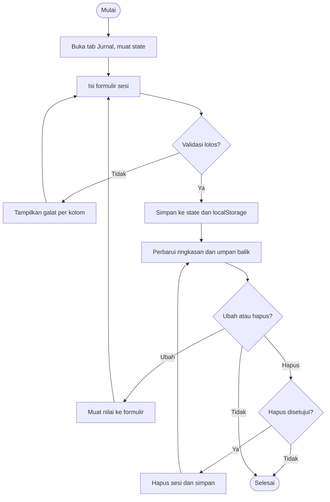

**Penjelasan.** Diagram ini menggambarkan siklus hidup satu catatan sesi belajar: dibuat, divalidasi,
disimpan, lalu dapat diubah atau dihapus. Ada dua titik keputusan yang menentukan kualitas data:

1. **Validasi (node F)** memeriksa durasi 0–24 jam, tanggal tidak melebihi hari ini, dan kolom wajib
   terisi. Tanpa gerbang ini, satu salah ketik — misalnya durasi 240 menit yang ditulis sebagai `240`
   jam — akan merusak standardisasi z-score dan menggeser seluruh centroid. Karena itu validasi
   diletakkan **sebelum** penyimpanan, bukan sebagai peringatan setelah data masuk.
2. **Konfirmasi hapus (node N)** memakai lembar bawah (*bottom sheet*) alih-alih `confirm()` bawaan
   peramban, agar gaya tetap konsisten dan tetap terbaca di layar sempit.

Node J adalah simpul yang menghubungkan fitur ini dengan fitur lain: setiap perubahan data sesi
langsung memicu perhitungan ulang dasbor dan analisis. Inilah sebabnya FR-01/FR-02 tidak berdiri
sendiri — keduanya adalah pintu masuk data bagi seluruh sistem.

**Kaitan kode.** `vJurnal()`, `formSesi()` (validasi), `simpan()`, `csvSesi()`, dan `Anim.lembar()`
untuk konfirmasi hapus.

---

### 3.2 AD-02 — Menyusun dasbor dan laporan pekan
**Penanggung jawab:** Aninda Rizqi Amelia (60124009) · **FR-03, FR-08**

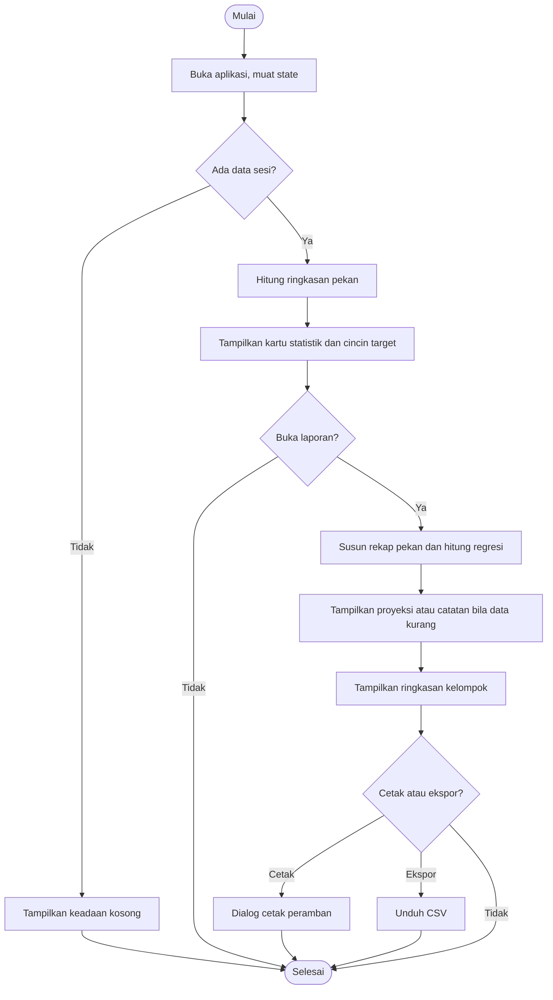

**Penjelasan.** Diagram ini menegaskan bahwa laporan **tidak menghitung ulang apa pun secara mandiri** —
ia membaca hasil yang sama dengan dasbor. Prinsip ini penting untuk konsistensi: angka total jam di
dasbor dan di laporan harus identik karena keduanya berasal dari satu fungsi `ringkasan()`. Bila
keduanya menghitung sendiri-sendiri, cepat atau lambat akan muncul selisih yang sulit dilacak.

Cabang **D** menangani keadaan kosong secara eksplisit. Ini bukan hiasan: aplikasi yang menampilkan
angka nol dan grafik kosong tanpa penjelasan membuat pengguna baru mengira aplikasinya rusak. Karena
itu keadaan kosong diberi ilustrasi dan satu ajakan bertindak.

Cabang **M** adalah pengaman statistik. Regresi linear membutuhkan minimal dua titik; dengan satu
pekan data, kemiringan garis tidak terdefinisi. Sistem memilih **menyatakan batas kemampuannya**
ketimbang menampilkan garis datar yang menyesatkan.

**Kaitan kode.** `vDasbor()`, `stat()`, `vLaporan()`, `Grafik.garis()`, `Grafik.ring()`, dan
`K.regresi()`.

---

### 3.3 AD-03 — Menjalankan analisis K-Means dan menyajikan visualisasi
**Penanggung jawab:** Maheswari Pasa Putri Syamsudar (60124010) · **FR-04, FR-05**

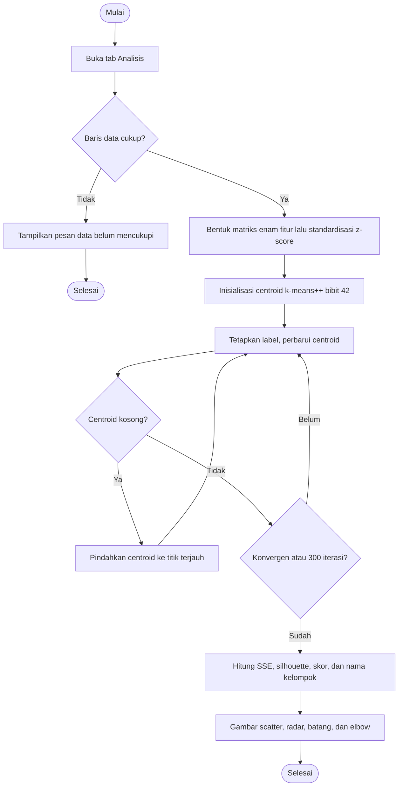

**Penjelasan.** Ini diagram paling padat karena menggambarkan inti komponen Data Sains. Tiga hal yang
perlu diperhatikan:

1. **Standardisasi (node G) dilakukan sebelum clustering, bukan sesudah.** Keenam fitur punya satuan
   berbeda — jam, hari, jumlah tugas. Tanpa z-score, fitur dengan rentang terbesar (durasi, 0–24 jam)
   akan mendominasi jarak dan lima fitur lain praktis diabaikan.
2. **Node L menangani centroid kosong.** Ini kegagalan klasik K-Means: satu centroid bisa kehilangan
   seluruh anggotanya sehingga pembagian rata-rata menjadi `0/0`. Penanganannya bukan mengabaikan,
   melainkan memindahkan centroid tersebut ke titik terjauh — cara yang menjaga keseimbangan tanpa
   menambah jumlah cluster.
3. **Node P adalah gerbang mutu, bukan gerbang kegagalan.** Silhouette rendah tidak membatalkan
   analisis; sistem tetap menampilkan hasil tetapi menandainya. Pengguna berhak melihat hasil yang
   lemah selama ia tahu bahwa hasil itu lemah.

Perulangan I→N adalah inti algoritma. Kondisi berhenti ganda (pergeseran ≤ 1e-6 **atau** 300 iterasi)
mencegah perulangan tak berujung bila data mengandung titik kembar yang membuat centroid berayun.

**Kaitan kode.** `K.analisis()`, `K.standardisasi()`, `K.kmeans()`, `K.silhouette()`, `K.elbow()`,
lalu `Grafik.sebar()`, `Grafik.radar()`, `Grafik.batang()`, `Grafik.elbow()`.

---

### 3.4 AD-04 — Mengelola dataset dan menempatkan posisi pengguna
**Penanggung jawab:** Hasan (60124013) · **FR-06, FR-07**

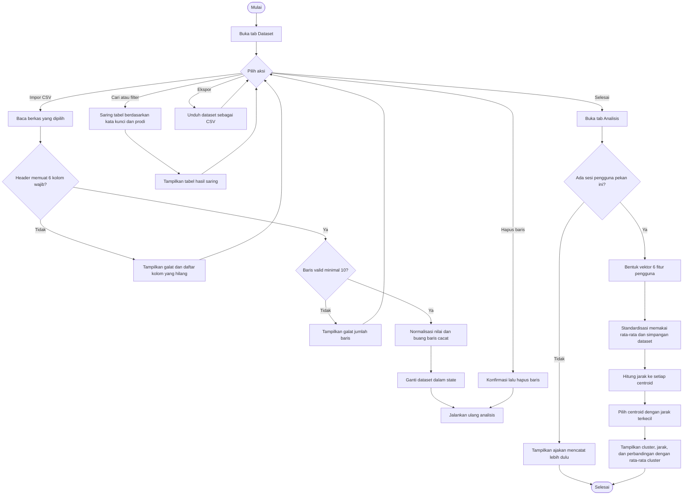

**Penjelasan.** Diagram ini menyatukan dua FR yang saling bergantung. FR-07 mengurus **data acuan**
(dataset 90 responden), sedangkan FR-06 memakai data acuan itu untuk menjawab pertanyaan "saya ada di
kelompok mana?".

Dua keputusan penting:

- **Validasi impor bertingkat (node E dan G).** Berkas CSV yang salah kolom akan menghasilkan
  `undefined` di seluruh perhitungan dan merusak analisis tanpa pesan yang jelas. Karena itu header
  diperiksa lebih dulu, baru jumlah baris. Pesan galatnya menyebutkan **kolom mana yang hilang**,
  bukan sekadar "format salah" — pengguna jadi tahu apa yang harus diperbaiki.
- **Node U memakai statistik dataset, bukan statistik pengguna.** Ini sering salah dipahami. Saat
  menempatkan satu vektor baru ke model yang sudah dilatih, standardisasinya harus memakai rata-rata
  dan simpangan **data latih**. Bila memakai statistik pengguna sendiri, satu titik akan selalu
  terstandardisasi ke nol dan jatuh ke cluster yang salah.

Node Q menjaga agar penempatan tidak dilakukan saat belum ada data: membandingkan "belum pernah
belajar" dengan responden sungguhan akan menghasilkan kesimpulan yang menyesatkan.

**Kaitan kode.** `vDataset()`, `imporCsv()`, `csvDataset()`, `contohData()`, dan `K.tempatkan()`.

---

### 3.5 AD-05 — Mengatur preferensi, panduan awal, dan saran kontekstual
**Penanggung jawab:** Sifa Sabrina (60124023) · **FR-09, FR-10, FR-11**

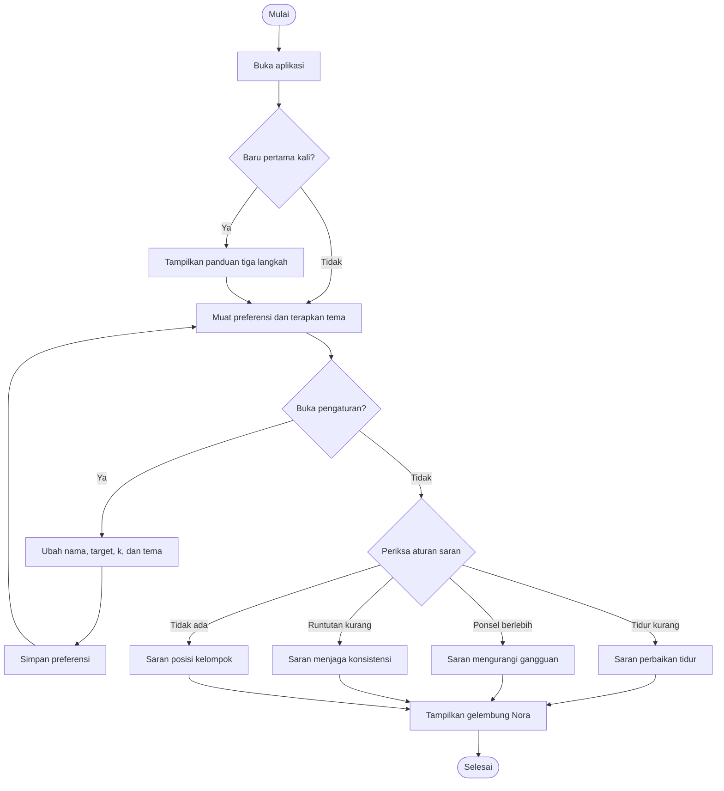

**Penjelasan.** Diagram ini menggambarkan lapisan yang membuat aplikasi terasa seperti pembimbing,
bukan sekadar papan angka. Tiga FR digabung karena ketiganya bekerja pada satu poros: **preferensi
pengguna menjadi konteks bagi saran**.

Urutan pemeriksaan pada node Q bersifat **prioritas, bukan acak**. Tidur diperiksa lebih dulu karena
kurang tidur adalah akar dari banyak masalah belajar lain — memberi saran "perbanyak durasi belajar"
kepada orang yang tidur lima jam justru memperburuk keadaannya. Setelah tidur, baru gangguan (HP),
lalu konsistensi, dan terakhir posisi cluster. Rantai ini berhenti pada aturan pertama yang cocok,
sehingga pengguna menerima **satu saran yang paling mendesak**, bukan daftar panjang yang tidak
terbaca.

Cabang **C** menangani onboarding. Panduan tiga langkah hanya muncul sekali, dan penandaannya
disimpan di preferensi (`sudahKenal`). Tanpa penanda ini, panduan akan muncul setiap kali halaman
dimuat ulang dan berubah dari bantuan menjadi gangguan.

Cabang **M** mencatat bahwa mengubah `k` berdampak langsung: nilai itu dipakai pada analisis
berikutnya, sehingga satu perubahan preferensi dapat mengubah jumlah cluster di seluruh tampilan.

**Kaitan kode.** `bukaKenalan()`, `bukaAtur()`, `terapkanTema()`, `wawasan()`, dan `Anim.nora()`.

---

## 4. Sequence Diagram

Sequence Diagram menunjukkan **pertukaran pesan antaroobjek menurut waktu**, melengkapi Activity
Diagram yang hanya menunjukkan urutan kegiatan. Kelima diagram memakai peserta yang sama agar dapat
dibaca sebagai satu sistem: `Aktor`, `UI`, `App`, `Store`, `KMeans`, dan `Grafik`.

### 4.1 SD-01 — Mencatat sesi belajar
**Penanggung jawab:** Yuniar Zahra Wiyani (60124004) · **FR-01, FR-02**

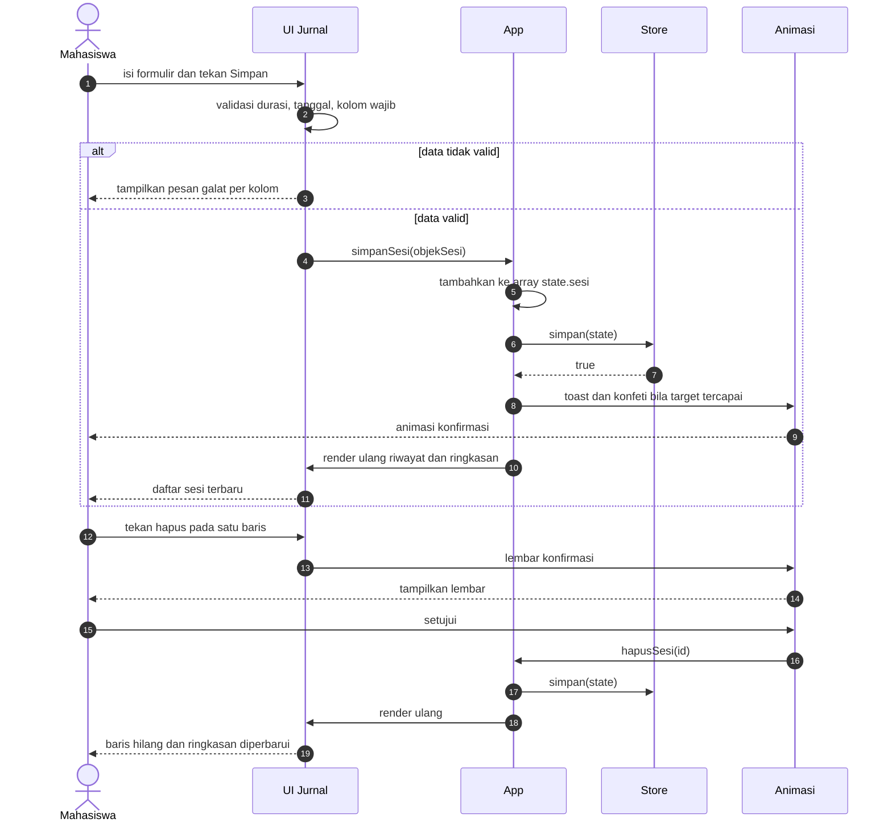

**Penjelasan.** Diagram ini memperlihatkan bahwa **validasi berada di lapisan UI, bukan di App**.
Alasannya praktis: pesan galat harus menempel pada kolom yang salah, dan hanya UI yang tahu kolom mana
itu. App menerima objek yang sudah bersih.

Perhatikan `alt` block: hanya cabang valid yang menyentuh `Store`. Artinya tidak ada penulisan ke
penyimpanan ketika data cacat — sifat yang penting karena `localStorage` tidak punya transaksi dan
tidak bisa di-*rollback*.

Pemanggilan `S.simpan(state)` terjadi **dua kali** (setelah tambah dan setelah hapus) karena strategi
penyimpanannya adalah *write-through*: seluruh state ditulis ulang setiap ada perubahan. Untuk data
sebesar ini (puluhan hingga ratusan sesi) biayanya tidak terasa, dan kesederhanaannya menghilangkan
seluruh kelas bug sinkronisasi.

**Kaitan kode.** `formSesi()`, `simpan()`, `Anim.toast()`, `Anim.konfeti()`, `Anim.lembar()`.

---

### 4.2 SD-02 — Menyusun dasbor dan laporan
**Penanggung jawab:** Aninda Rizqi Amelia (60124009) · **FR-03, FR-08**

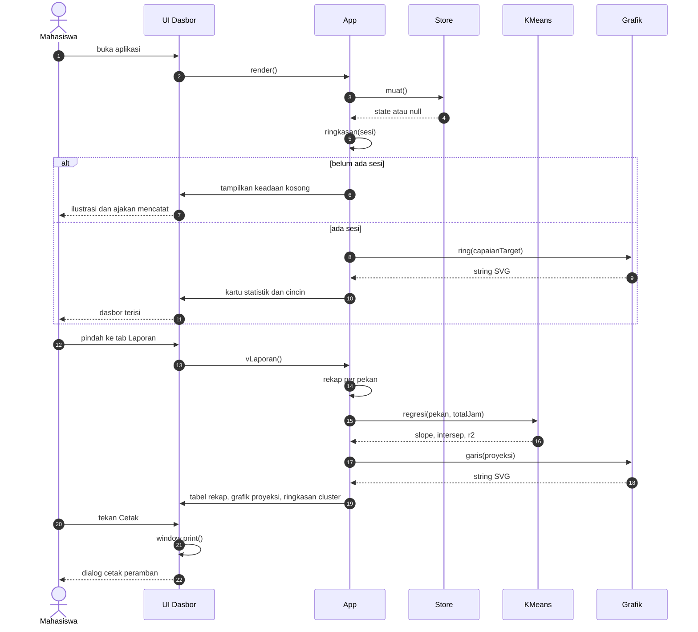

**Penjelasan.** Diagram ini menunjukkan pola **render berbasis fungsi murni**: `App` tidak menyimpan
potongan HTML di banyak tempat, melainkan memanggil `vLaporan()` yang membangun tampilan dari state
saat itu. Konsekuensinya, setiap perubahan state otomatis tercermin di semua tab tanpa kode
penyelarasan tambahan.

`K.regresi()` mengembalikan tiga nilai — kemiringan, intersep, dan R². R² ikut ditampilkan karena
proyeksi tanpa ukuran kebaikan adalah klaim tanpa dasar: garis bisa terlihat rapi padahal tidak
menjelaskan data sama sekali.

Pemanggilan `window.print()` sengaja dipilih alih-alih pustaka pembuat PDF. Peramban sudah punya
mesin tata letak cetak yang matang, dan CSS `@media print` pada proyek ini menyembunyikan latar kota,
tab bar, dan tombol sehingga hasil cetaknya bersih. Menambahkan pustaka PDF berarti mengunduh ratusan
kilobita untuk pekerjaan yang sudah tersedia gratis.

**Kaitan kode.** `vDasbor()`, `stat()`, `vLaporan()`, `K.regresi()`, `Grafik.garis()`,
`Grafik.ring()`.

---

### 4.3 SD-03 — Menjalankan analisis K-Means
**Penanggung jawab:** Maheswari Pasa Putri Syamsudar (60124010) · **FR-04, FR-05**

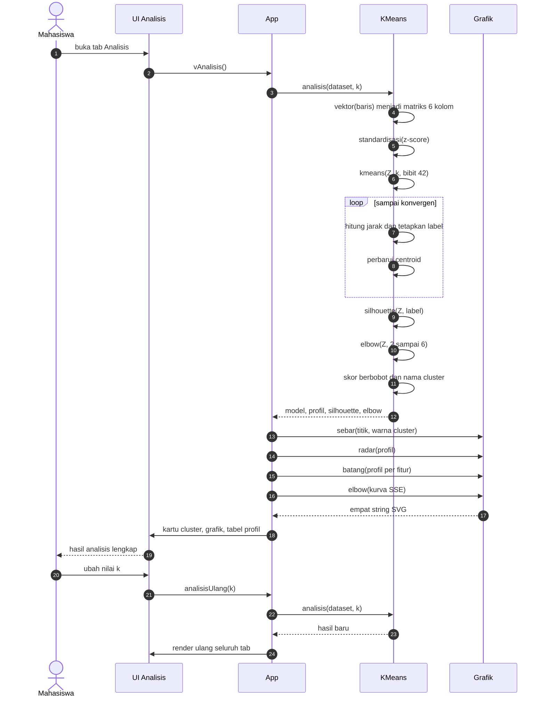

**Penjelasan.** Diagram ini adalah jantung integrasi Data Sains. Terlihat bahwa `KMeans` **tidak tahu
apa pun tentang DOM** — ia hanya menerima array objek dan mengembalikan objek hasil. Pemisahan ini
bukan gaya-gayaan: karena murni, modul yang sama dapat dijalankan di Node untuk pengujian unit
(`tests/kmeans.test.mjs`, 8 kasus) tanpa perlu peramban atau DOM tiruan.

Blok `loop` menggambarkan iterasi algoritma. Bibit acak `42` diteruskan secara eksplisit supaya hasil
dapat direproduksi: dua kali menjalankan analisis pada data yang sama menghasilkan cluster yang sama
persis. Tanpa bibit tetap, demonstrasi di depan kelas bisa memberi hasil berbeda dari yang tertulis di
laporan — kesan yang merugikan padahal algoritmanya benar.

`elbow()` dipanggil untuk k = 2 sampai 6 sekaligus, bukan hanya untuk k terpilih, karena grafik elbow
adalah alat **pembenaran** pemilihan k. Menjalankannya hanya untuk satu nilai akan menghilangkan
gunanya.

Empat grafik dibangun dari satu objek hasil yang sama. Ini memastikan scatter, radar, batang, dan
tabel profil tidak mungkin saling bertentangan.

**Kaitan kode.** `K.analisis()`, `K.kmeans()`, `K.silhouette()`, `K.elbow()`, `Grafik.sebar()`,
`Grafik.radar()`, `Grafik.batang()`, `Grafik.elbow()`.

---

### 4.4 SD-04 — Mengimpor dataset dan menempatkan posisi pengguna
**Penanggung jawab:** Hasan (60124013) · **FR-06, FR-07**

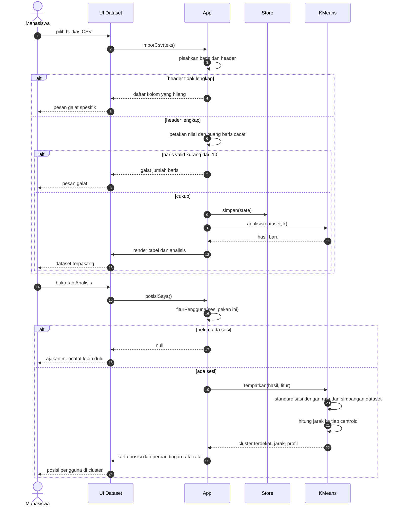

**Penjelasan.** Ada dua `alt` bertingkat pada bagian impor. Ini mencerminkan dua jenis kegagalan yang
berbeda dan harus dibedakan pesannya: **salah bentuk** (kolom tidak ada) dan **salah isi** (baris
terlalu sedikit). Menyatukan keduanya menjadi satu pesan "impor gagal" akan memaksa pengguna menebak.

Perhatikan bahwa `K.analisis()` dipanggil **setelah** dataset diganti, bukan sebelumnya. Urutan ini
penting: bila analisis dijalankan lebih dulu, tabel dan grafik akan menampilkan hasil dari data lama
sementara tabel sudah menampilkan data baru — keadaan tidak konsisten yang membingungkan.

Bagian penempatan memakai `K.tempatkan()` yang **tidak melatih ulang model**. Model hasil pelatihan
pada dataset dianggap tetap; vektor pengguna hanya diproyeksikan ke ruang yang sudah ada. Ini perilaku
yang benar secara metodologis: menambahkan satu titik ke pelatihan akan menggeser centroid dan membuat
posisi semua responden berubah hanya karena satu mahasiswa mencatat sesinya.

**Kaitan kode.** `imporCsv()`, `csvDataset()`, `contohData()`, `K.tempatkan()`, `fiturPengguna()`.

---

### 4.5 SD-05 — Mengatur preferensi dan menerima saran
**Penanggung jawab:** Sifa Sabrina (60124023) · **FR-09, FR-10, FR-11**

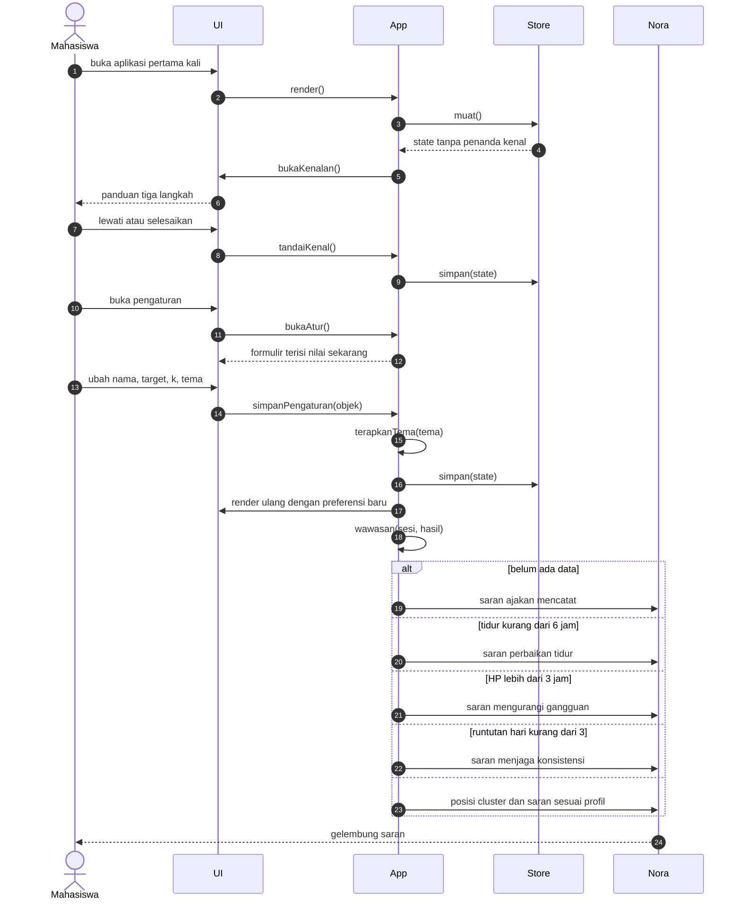

**Penjelasan.** Diagram ini memperlihatkan `wawasan()` sebagai **rantai `alt`/`else` berprioritas**,
bukan kumpulan aturan yang semuanya dijalankan. Hanya satu cabang yang dieksekusi — cabang pertama yang
kondisinya benar. Inilah yang membuat saran terasa seperti nasihat seorang pembimbing, bukan keluaran
sistem pakar yang menumpahkan semua aturan sekaligus.

Urutan prioritasnya punya alasan yang bisa dipertanggungjawabkan: tidur sebelum HP, HP sebelum
konsistensi, konsistensi sebelum posisi cluster. Saran tentang posisi cluster diletakkan terakhir
karena sifatnya paling umum — ia baru berguna setelah kebutuhan dasar (tidur, gangguan, keteraturan)
terpenuhi.

`terapkanTema()` dipanggil **sebelum** `simpan()`. Bila dibalik, akan ada jeda singkat ketika state
sudah menyimpan tema baru tetapi layar masih menampilkan tema lama. Untuk operasi secepat ini jedanya
tak terlihat, tetapi urutannya tetap dibuat benar agar tidak menjadi kebiasaan buruk.

Perhatikan bahwa Nora tidak memanggil model apa pun. Saran dihasilkan dari aturan ambang yang dapat
dibaca manusia, bukan dari model kotak hitam. Untuk nasihat belajar, kemampuan menjelaskan **mengapa**
sebuah saran muncul lebih bernilai daripada kecanggihan modelnya.

**Kaitan kode.** `bukaKenalan()`, `bukaAtur()`, `terapkanTema()`, `wawasan()`, `Anim.nora()`.

---

## 5. Class Diagram

### 5.1 Diagram

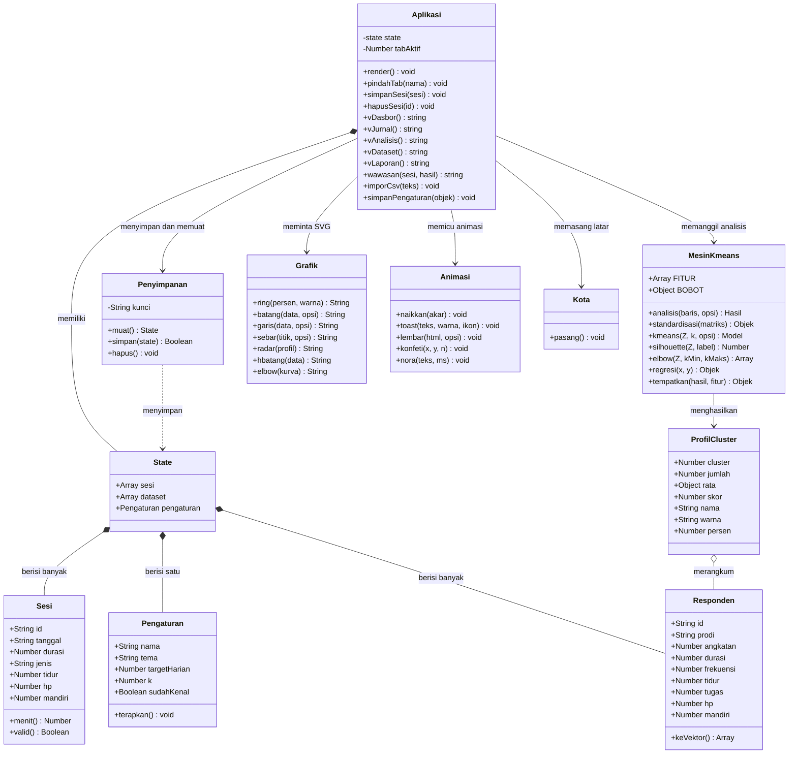

### 5.2 Penjelasan

**Jumlah dan alasan pemilihan kelas.** Diagram ini memuat **10 kelas**, melebihi syarat minimal 5 pada
spesifikasi. Kelas-kelas itu bukan hasil memecah satu kelas menjadi banyak kotak, melainkan mengikuti
tanggung jawab yang memang sudah terpisah di kode:

| Kelas | Tanggung jawab tunggal | Berkas |
|-------|------------------------|--------|
| `Aplikasi` | Mengatur state dan membangun tampilan tiap tab | `assets/js/app.js` |
| `Penyimpanan` | Satu-satunya pintu ke `localStorage` | `app.js` (`muat`, `simpan`) |
| `State` | Bentuk data yang hidup selama sesi | `app.js` |
| `Sesi` | Satu catatan belajar beserta aturan validasinya | `app.js` (`formSesi`) |
| `Pengaturan` | Preferensi pengguna | `app.js` (`bukaAtur`) |
| `Responden` | Satu baris dataset survei | `assets/js/dataset.js` |
| `MesinKmeans` | Seluruh perhitungan Data Sains | `assets/js/kmeans.js` |
| `ProfilCluster` | Ringkasan satu cluster | `kmeans.js` (`analisis`) |
| `Grafik` | Mengubah angka menjadi SVG | `assets/js/grafik.js` |
| `Animasi` | Umpan balik visual | `assets/js/animasi.js` |
| `Kota` | Latar kota beranimasi | `assets/js/kota.js` |

**Hubungan antarkelas.**

- **Komposisi (`*--`)** dipakai antara `Aplikasi`–`State` dan `State`–`Sesi`/`Pengaturan`/`Responden`.
  Artinya siklus hidupnya terikat: bila state dimusnahkan, sesi dan responden di dalamnya ikut hilang.
  Ini sesuai kenyataan — data sesi tidak punya makna di luar pemiliknya.
- **Asosiasi (`-->`)** dipakai dari `Aplikasi` ke `Penyimpanan`, `MesinKmeans`, `Grafik`, `Animasi`,
  dan `Kota`. Kelima kelas itu **berdiri sendiri**: `MesinKmeans` tetap utuh walau `Aplikasi` tidak
  ada. Inilah yang memungkinkan modul K-Means diuji tanpa peramban.
- **Dependensi (`..>`)** dari `Penyimpanan` ke `State` menandai hubungan yang lebih lemah: penyimpanan
  hanya serialisasi/deserialisasi, tidak memiliki state.
- **Agregasi (`o--`)** dari `ProfilCluster` ke `Responden` menandai bahwa profil *merangkum* responden
  tetapi tidak memilikinya. Menghapus satu profil tidak boleh menghapus respondennya.

**Atribut dan operasi yang dipilih.** Hanya anggota yang menjelaskan perilaku yang dicantumkan. `Sesi`
memuat `menit()` dan `valid()` karena dua operasi itulah yang membedakannya dari sekadar objek data —
tanpa keduanya, `Sesi` tidak lebih dari kamus. Sebaliknya atribut tampilan seperti warna tombol tidak
dimasukkan karena bukan bagian dari model domain.

`MesinKmeans` sengaja mengekspos `FITUR` dan `BOBOT` sebagai atribut publik. Keduanya adalah
**konfigurasi domain**, bukan detail internal: mengubah bobot berarti mengubah definisi "kebiasaan
tinggi", dan itu keputusan yang harus terlihat, bukan tersembunyi di dalam fungsi.

**Kaitan dengan implementasi.** Setiap kelas di atas punya berkas nyata. Ini bukan diagram yang
digambar setelah kode selesai sebagai pelengkap laporan — strukturnya memang mengikuti pemisahan modul
yang sudah ada, sehingga dosen dapat membuka berkas yang disebut pada kolom terakhir dan mencocokkannya
baris per baris.

---

## 6. Keterbatasan perancangan yang diakui

Dua hal berikut sengaja dicatat terbuka, bukan disembunyikan:

1. **Pemisahan peran belum ditegakkan secara teknis.** Use Case Diagram memuat tiga aktor, tetapi
   versi web saat ini hanya mengimplementasikan peran Mahasiswa. Dosen PA dan Pengelola Data
   dijalankan oleh orang yang sama. Autentikasi dan otorisasi dirancang pada Tahap 4 (rancangan basis
   data sudah menyiapkan tabel `pengguna` dengan kolom `peran`) dan diimplementasikan pada Tahap 5.
2. **Activity Diagram menggambarkan alur yang berlaku untuk satu pengguna pada satu perangkat.**
   Sinkronisasi antarpengguna belum menjadi bagian rancangan ini karena penyimpanan masih lokal.
   Rancangan basis data pada Tahap 4 sudah menyiapkan jalur menuju keadaan itu.

---

## 7. Riwayat dokumen

| Tanggal | Versi | Perubahan |
|---------|-------|-----------|
| 27 November 2026 | v1.0 | Dokumen perancangan UML disusun: 1 use case, 5 activity, 5 sequence, 1 class diagram |
