# LAPORAN TAHAP 4 — PERANCANGAN SISTEM DAN BASIS DATA

| | |
|---|---|
| **Proyek** | StudyTrack — Aplikasi Analisis Kebiasaan Belajar Mahasiswa dengan K-Means Clustering |
| **Mata kuliah** | Rekayasa Perangkat Lunak (SSD30) |
| **Program studi** | Data Sains · Fakultas Sains dan Teknologi |
| **Institusi** | UIN K.H. Abdurrahman Wahid Pekalongan |
| **Tahap** | 4 dari 8 — Perancangan Sistem dan Basis Data |
| **Versi dokumen** | v1.0 · 27 November 2026 |

---

## 1. Ruang lingkup perancangan teknis

Dokumen ini menjawab enam hal yang diminta spesifikasi bagian 7 (Tahap 4): arsitektur aplikasi,
rancangan basis data, relasi antartabel, rancangan antarmuka, teknologi yang digunakan, dan rancangan
integrasi komponen Data Sains.

| No | Butir yang diminta | Bagian dokumen |
|:--:|--------------------|----------------|
| 1 | Arsitektur aplikasi | §2 |
| 2 | Rancangan basis data | §3.2 – §3.4 |
| 3 | Relasi antartabel | §3.3 |
| 4 | Rancangan antarmuka pengguna | §4 |
| 5 | Teknologi yang digunakan | §5 |
| 6 | Integrasi aplikasi dan komponen Data Sains | §6 |

Rancangan ini **tidak dimulai dari nol**. Versi web sudah berjalan, sehingga setiap keputusan di sini
berangkat dari kenyataan yang sudah diuji, bukan dari bayangan. Di beberapa tempat dokumen ini
menyebutkan dua keadaan secara eksplisit: **keadaan sekarang** (Tahap 5 selesai sebagian) dan
**keadaan target** (Tahap 5 penuh). Perbedaan itu disengaja agar tidak ada klaim yang berlebihan.

---

## 2. Arsitektur aplikasi

### 2.1 Gaya arsitektur yang dipilih

StudyTrack memakai **arsitektur berlapis (layered architecture)** dengan pemisahan tegas antara
lapisan tampilan, lapisan logika aplikasi, lapisan Data Sains, dan lapisan data. Alasannya bukan
preferensi gaya, melainkan kebutuhan pengujian: komponen Data Sains harus dapat diuji tanpa peramban.

Tiga prinsip yang dipegang:

1. **Logika Data Sains tidak boleh menyentuh DOM.** Modul `kmeans.js` hanya menerima array dan
   mengembalikan objek. Karena itu ia dapat dijalankan di Node dan diuji dengan `node:test`.
2. **Tampilan adalah fungsi dari state.** Setiap tab dibangun ulang dari state saat itu, bukan diubah
   sepotong-sepotong. Satu sumber kebenaran, tanpa kode penyelarasan.
3. **Data mengalir satu arah.** Aksi pengguna → perubahan state → penyimpanan → render ulang. Tidak ada
   jalur balik yang menyentuh DOM secara langsung.

### 2.2 Diagram arsitektur

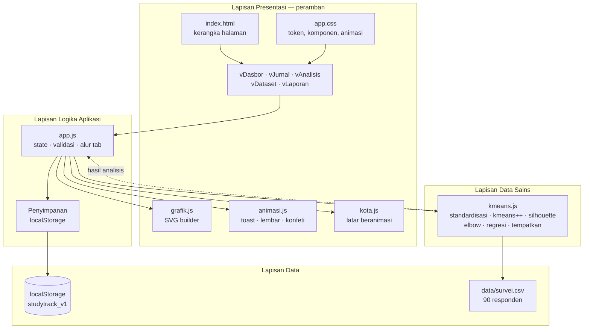

### 2.3 Penjelasan tiap lapisan

| Lapisan | Isi | Tanggung jawab | Tidak boleh melakukan |
|---------|-----|----------------|------------------------|
| Presentasi | `index.html`, `app.css`, `grafik.js`, `animasi.js`, `kota.js` | Menampilkan state, menerima masukan, memberi umpan balik visual | Menghitung statistik, menyentuh `localStorage` |
| Logika aplikasi | `app.js` | Menjaga state, memvalidasi masukan, mengatur alur antar tab | Menggambar SVG secara manual, menghitung jarak Euclidean |
| Data Sains | `kmeans.js` | Standardisasi, clustering, validasi cluster, regresi, penempatan | Menyentuh DOM, membaca `localStorage` |
| Data | `localStorage`, `data/survei.csv` | Menyimpan state dan dataset acuan | Mengandung logika bisnis |

Pemisahan ini punya akibat yang dapat diperiksa: menghapus seluruh berkas CSS tidak membuat
`node --test tests/kmeans.test.mjs` gagal, karena mesin Data Sains memang tidak bergantung pada
tampilan.

### 2.4 Arsitektur target (Tahap 5 penuh)

Versi web sekarang menyimpan data di peramban. Itu cukup untuk satu pengguna di satu perangkat, tetapi
tidak cukup bila dosen PA perlu membaca data mahasiswa bimbingannya. Karena itu dirancang jalur
peningkatan tanpa membongkar arsitektur:

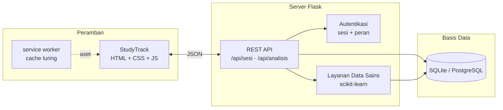

Kunci perancangannya: **antarmuka antara peramban dan server adalah JSON, bukan HTML**. Artinya
lapisan presentasi yang sudah ada tetap dipakai; hanya `Penyimpanan` yang berganti tujuan dari
`localStorage` ke `fetch()`. Inilah sebabnya `Penyimpanan` sengaja dibuat sebagai satu kelas tersendiri
dengan tiga operasi (`muat`, `simpan`, `hapus`) — ia adalah satu-satunya titik yang perlu diubah.

### 2.5 Alur data satu siklus penuh

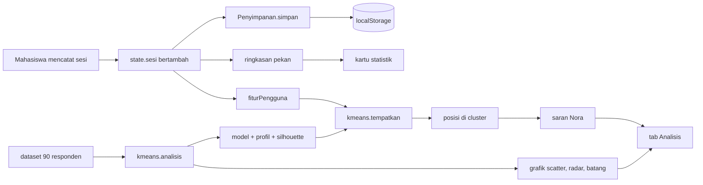

Diagram ini menjelaskan mengapa satu sesi yang dicatat langsung mengubah tiga tempat sekaligus:
dasbor, tab analisis, dan saran Nora. Semuanya membaca dari state yang sama, sehingga tidak mungkin
saling bertentangan.

---

## 3. Rancangan basis data

### 3.1 Prinsip perancangan

Lima keputusan yang membentuk skema di bawah:

1. **Data pribadi dan data acuan dipisahkan.** `sesi_belajar` adalah catatan milik satu mahasiswa;
   `responden` adalah data survei yang menjadi acuan clustering. Menggabungkannya akan membuat
   "hapus riwayat saya" ikut menghapus dataset penelitian — kesalahan yang fatal dan tidak dapat
   dibatalkan.
2. **Hasil analisis disimpan sebagai snapshot, bukan dihitung ulang saat dibaca.** `analisis` dan
   `profil_cluster` menyimpan nilai pada saat analisis dijalankan. Bila dataset berubah, hasil lama
   tetap sah sebagai catatan sejarah.
3. **Dataset dapat lebih dari satu.** Karena impor CSV diizinkan, `responden` bergantung pada `dataset`,
   bukan langsung pada pengguna. Ini memungkinkan perbandingan antar-dataset tanpa mengubah skema.
4. **Semua nilai fitur disimpan dalam satuan asli.** Z-score dihitung saat analisis, tidak disimpan.
   Menyimpan nilai terstandardisasi akan mengunci data pada satu rata-rata tertentu — begitu dataset
   berubah, seluruh nilai tersimpan menjadi salah.
5. **Basis data menegakkan batas, bukan hanya aplikasi.** `CHECK` pada kolom durasi dan tidur mencegah
   data mustahil masuk, bahkan bila ada jalur impor yang lupa memvalidasi.

### 3.2 Entity Relationship Diagram

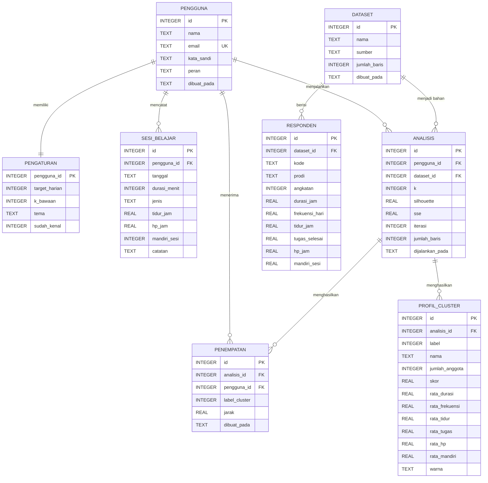

### 3.3 Relasi antartabel

| No | Relasi | Kardinalitas | Kunci | Aturan hapus | Alasan |
|:--:|--------|:------------:|-------|--------------|--------|
| R1 | `pengguna` → `pengaturan` | 1 : 1 | `pengaturan.pengguna_id` | `ON DELETE CASCADE` | Preferensi tidak bermakna tanpa pemiliknya |
| R2 | `pengguna` → `sesi_belajar` | 1 : N | `sesi_belajar.pengguna_id` | `ON DELETE CASCADE` | Sesi adalah milik pribadi; hapus akun = hapus sesi |
| R3 | `dataset` → `responden` | 1 : N | `responden.dataset_id` | `ON DELETE CASCADE` | Responden hanya ada di dalam satu dataset |
| R4 | `pengguna` → `analisis` | 1 : N | `analisis.pengguna_id` | `ON DELETE SET NULL` | Riwayat analisis tetap berguna untuk audit meski akun dihapus |
| R5 | `dataset` → `analisis` | 1 : N | `analisis.dataset_id` | `ON DELETE RESTRICT` | Dataset yang sudah dipakai analisis tidak boleh hilang diam-diam |
| R6 | `analisis` → `profil_cluster` | 1 : N | `profil_cluster.analisis_id` | `ON DELETE CASCADE` | Profil adalah bagian tak terpisahkan dari satu hasil analisis |
| R7 | `analisis` → `penempatan` | 1 : N | `penempatan.analisis_id` | `ON DELETE CASCADE` | Penempatan hanya bermakna terhadap model tertentu |
| R8 | `pengguna` → `penempatan` | 1 : N | `penempatan.pengguna_id` | `ON DELETE CASCADE` | Riwayat posisi milik satu mahasiswa |

**Catatan penting pada R4 dan R5.** Keduanya sengaja **tidak** memakai `CASCADE`, dan alasannya
berbeda:

- R4 memakai `SET NULL` karena hasil analisis adalah **bukti**, bukan pelengkap. Bila akun mahasiswa
  dihapus, catatan bahwa "pada 27 November 2026 dijalankan k=3 dengan silhouette 0,355" masih berguna
  untuk mempertanggungjawabkan laporan. Yang hilang cukup kaitannya ke orang.
- R5 memakai `RESTRICT` karena menghapus dataset yang sudah menjadi bahan analisis akan membuat
  `analisis` menunjuk ke ketiadaan. Basis data menolak lebih dulu, sebelum ada data yatim.

Perbedaan dua aturan ini adalah contoh bahwa kardinalitas saja tidak cukup — **semantik penghapusan**
harus diputuskan per relasi, bukan diseragamkan.

### 3.4 Definisi tabel (DDL SQLite)

```sql
PRAGMA foreign_keys = ON;

CREATE TABLE pengguna (
  id          INTEGER PRIMARY KEY AUTOINCREMENT,
  nama        TEXT    NOT NULL CHECK (length(trim(nama)) BETWEEN 2 AND 60),
  email       TEXT    NOT NULL UNIQUE,
  kata_sandi  TEXT    NOT NULL,                     -- argon2id, bukan teks biasa
  peran       TEXT    NOT NULL DEFAULT 'mahasiswa'
                      CHECK (peran IN ('mahasiswa','dosen','pengelola')),
  dibuat_pada TEXT    NOT NULL DEFAULT (datetime('now'))
);

CREATE TABLE pengaturan (
  pengguna_id   INTEGER PRIMARY KEY REFERENCES pengguna(id) ON DELETE CASCADE,
  target_harian INTEGER NOT NULL DEFAULT 120 CHECK (target_harian BETWEEN 15 AND 720),
  k_bawaan      INTEGER NOT NULL DEFAULT 3   CHECK (k_bawaan BETWEEN 2 AND 6),
  tema          TEXT    NOT NULL DEFAULT 'gelap' CHECK (tema IN ('gelap','terang')),
  sudah_kenal   INTEGER NOT NULL DEFAULT 0   CHECK (sudah_kenal IN (0,1))
);

CREATE TABLE sesi_belajar (
  id           INTEGER PRIMARY KEY AUTOINCREMENT,
  pengguna_id  INTEGER NOT NULL REFERENCES pengguna(id) ON DELETE CASCADE,
  tanggal      TEXT    NOT NULL,                    -- ISO 8601: YYYY-MM-DD
  durasi_menit INTEGER NOT NULL CHECK (durasi_menit BETWEEN 1 AND 1440),
  jenis        TEXT    NOT NULL DEFAULT 'mandiri'
                       CHECK (jenis IN ('mandiri','kelompok','tugas','ujian')),
  tidur_jam    REAL    NOT NULL CHECK (tidur_jam BETWEEN 0 AND 24),
  hp_jam       REAL    NOT NULL DEFAULT 0 CHECK (hp_jam BETWEEN 0 AND 24),
  mandiri_sesi INTEGER NOT NULL DEFAULT 0 CHECK (mandiri_sesi BETWEEN 0 AND 20),
  catatan      TEXT,
  dibuat_pada  TEXT    NOT NULL DEFAULT (datetime('now'))
);
CREATE INDEX idx_sesi_pengguna_tanggal ON sesi_belajar(pengguna_id, tanggal);

CREATE TABLE dataset (
  id           INTEGER PRIMARY KEY AUTOINCREMENT,
  nama         TEXT    NOT NULL,
  sumber       TEXT    NOT NULL DEFAULT 'impor',
  jumlah_baris INTEGER NOT NULL DEFAULT 0,
  dibuat_pada  TEXT    NOT NULL DEFAULT (datetime('now'))
);

CREATE TABLE responden (
  id             INTEGER PRIMARY KEY AUTOINCREMENT,
  dataset_id     INTEGER NOT NULL REFERENCES dataset(id) ON DELETE CASCADE,
  kode           TEXT    NOT NULL,
  prodi          TEXT    NOT NULL,
  angkatan       INTEGER NOT NULL CHECK (angkatan BETWEEN 2000 AND 2100),
  durasi_jam     REAL    NOT NULL CHECK (durasi_jam     BETWEEN 0 AND 24),
  frekuensi_hari REAL    NOT NULL CHECK (frekuensi_hari BETWEEN 0 AND 7),
  tidur_jam      REAL    NOT NULL CHECK (tidur_jam      BETWEEN 0 AND 24),
  tugas_selesai  REAL    NOT NULL CHECK (tugas_selesai  BETWEEN 0 AND 50),
  hp_jam         REAL    NOT NULL CHECK (hp_jam         BETWEEN 0 AND 24),
  mandiri_sesi   REAL    NOT NULL CHECK (mandiri_sesi   BETWEEN 0 AND 50),
  UNIQUE (dataset_id, kode)
);
CREATE INDEX idx_responden_dataset ON responden(dataset_id);

CREATE TABLE analisis (
  id             INTEGER PRIMARY KEY AUTOINCREMENT,
  pengguna_id    INTEGER REFERENCES pengguna(id) ON DELETE SET NULL,
  dataset_id     INTEGER NOT NULL REFERENCES dataset(id) ON DELETE RESTRICT,
  k              INTEGER NOT NULL CHECK (k BETWEEN 2 AND 10),
  silhouette     REAL    NOT NULL CHECK (silhouette BETWEEN -1 AND 1),
  sse            REAL    NOT NULL,
  iterasi        INTEGER NOT NULL,
  jumlah_baris   INTEGER NOT NULL,
  dijalankan_pada TEXT   NOT NULL DEFAULT (datetime('now'))
);

CREATE TABLE profil_cluster (
  id             INTEGER PRIMARY KEY AUTOINCREMENT,
  analisis_id    INTEGER NOT NULL REFERENCES analisis(id) ON DELETE CASCADE,
  label          INTEGER NOT NULL,
  nama           TEXT    NOT NULL,
  jumlah_anggota INTEGER NOT NULL,
  skor           REAL    NOT NULL,
  rata_durasi    REAL    NOT NULL,
  rata_frekuensi REAL    NOT NULL,
  rata_tidur     REAL    NOT NULL,
  rata_tugas     REAL    NOT NULL,
  rata_hp        REAL    NOT NULL,
  rata_mandiri   REAL    NOT NULL,
  warna          TEXT    NOT NULL DEFAULT '#22d3ee',
  UNIQUE (analisis_id, label)
);

CREATE TABLE penempatan (
  id            INTEGER PRIMARY KEY AUTOINCREMENT,
  analisis_id   INTEGER NOT NULL REFERENCES analisis(id)  ON DELETE CASCADE,
  pengguna_id   INTEGER NOT NULL REFERENCES pengguna(id)  ON DELETE CASCADE,
  label_cluster INTEGER NOT NULL,
  jarak         REAL    NOT NULL,
  dibuat_pada   TEXT    NOT NULL DEFAULT (datetime('now'))
);

CREATE VIEW v_rekap_pekan AS
SELECT pengguna_id,
       strftime('%Y-W%W', tanggal)          AS pekan,
       COUNT(*)                             AS jumlah_sesi,
       SUM(durasi_menit)                    AS total_menit,
       ROUND(AVG(durasi_menit), 1)          AS rata_menit,
       ROUND(AVG(tidur_jam), 1)             AS rata_tidur,
       ROUND(AVG(hp_jam), 1)                AS rata_hp
FROM   sesi_belajar
GROUP  BY pengguna_id, pekan;
```

### 3.5 Normalisasi

| Bentuk | Pemeriksaan | Hasil |
|--------|-------------|-------|
| **1NF** | Semua kolom bernilai atomik; tidak ada kolom berisi daftar | Lolos. Daftar sesi tidak disimpan sebagai teks gabungan di `pengguna`, melainkan sebagai baris di `sesi_belajar` |
| **2NF** | Tidak ada ketergantungan parsial pada kunci komposit | Lolos. Semua tabel memakai kunci tunggal (`id`), sehingga ketergantungan parsial tidak mungkin terjadi |
| **3NF** | Tidak ada ketergantungan transitif antar-kolom bukan kunci | Lolos. `nama` cluster disimpan di `profil_cluster`, bukan diduplikasi ke `analisis`; `prodi` disimpan di `responden`, tidak diulang di tabel lain |

**Satu penyimpangan yang disengaja.** `profil_cluster` menyimpan `rata_durasi`, `rata_frekuensi`, dan
seterusnya — nilai yang secara teori dapat dihitung ulang dari `responden`. Ini **denormalisasi yang
disadari**, dengan tiga alasan:

1. Nilai itu adalah **hasil pada satu waktu tertentu**. Bila dataset diimpor ulang dengan isi berbeda,
   rata-rata lama tidak dapat direkonstruksi dari data baru.
2. Menghitung ulang setiap kali halaman dibuka berarti menjalankan clustering berulang kali hanya untuk
   menampilkan angka yang sudah pernah dihitung.
3. Yang disimpan bukan data mentah, melainkan **ringkasan yang tidak dapat diturunkan kembali** —
   berbeda dari menduplikasi kolom yang bisa di-`JOIN`.

### 3.6 Pemetaan state peramban ke tabel

Versi web sekarang menyimpan satu objek JSON di `localStorage`. Pemetaannya ke skema di atas:

| Properti di `state` | Tabel tujuan | Catatan |
|---------------------|--------------|---------|
| `sesi[]` | `sesi_belajar` | `durasi` dalam menit, sudah sesuai kolom `durasi_menit` |
| `dataset[]` | `responden` (+ satu baris `dataset`) | Saat impor, satu `dataset` baru dibuat |
| `pengaturan` | `pengaturan` | Nama dipindah ke `pengguna.nama` |
| *(hasil `analisis()`)* | `analisis` + `profil_cluster` | Kini hanya hidup di memori, belum dipersistensi |

Baris terakhir adalah celah yang jujur harus disebut: hasil analisis saat ini **tidak disimpan**,
selalu dihitung ulang saat tab dibuka. Untuk satu pengguna dengan 90 baris data, biayanya sekitar
11 ms sehingga tidak terasa. Pada skala banyak pengguna, tabel `analisis` menjadi wajib.

---

## 4. Rancangan antarmuka pengguna

### 4.1 Model navigasi

Antarmuka memakai **satu halaman dengan lima tab** dan **lembar bawah (bottom sheet)** untuk tugas
sementara. Tidak ada halaman terpisah, tidak ada muat ulang antar bagian.

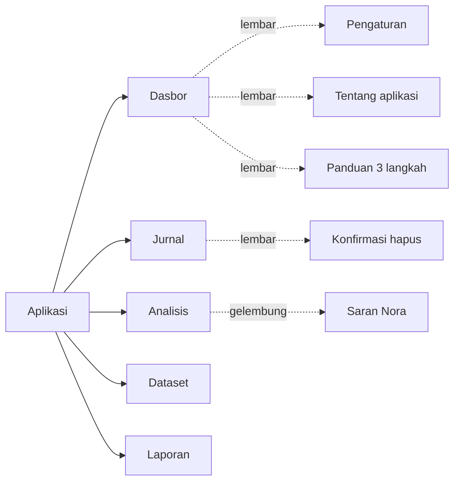

Alasan lima tab, bukan menu bertingkat: aplikasi ini punya lima pekerjaan utama yang semuanya sering
dipakai. Menu bertingkat akan menambah satu ketukan pada setiap perpindahan tanpa menghemat apa pun.

### 4.2 Daftar layar

| No | Layar | Fungsi | FR | Berkas rujukan |
|:--:|-------|--------|----|----------------|
| 1 | Dasbor | Ringkasan pekan, capaian target, runtutan hari, posisi cluster | FR-03 | `vDasbor()` |
| 2 | Jurnal | Formulir catat sesi + riwayat + aksi ubah/hapus | FR-01, FR-02 | `vJurnal()` |
| 3 | Analisis | Scatter, radar, batang profil, elbow, kartu cluster | FR-04, FR-05 | `vAnalisis()` |
| 4 | Dataset | Tabel 90 responden, cari, filter, impor, ekspor | FR-06, FR-07 | `vDataset()` |
| 5 | Laporan | Rekap pekan, proyeksi regresi, cetak, ekspor | FR-08 | `vLaporan()` |
| 6 | Lembar pengaturan | Nama, target, k, tema, hapus data | FR-09 | `bukaAtur()` |
| 7 | Lembar panduan | Tur tiga langkah saat pertama dibuka | FR-10 | `bukaKenalan()` |
| 8 | Gelembung saran | Satu saran kontekstual dari Nora | FR-11 | `wawasan()` |

### 4.3 Tata letak dan sistem visual

Rancangan memakai **grid 4 titik** dengan tiga titik henti:

| Titik henti | Lebar | Perubahan tata letak |
|-------------|-------|----------------------|
| Seluler | ≤ 520 px | Satu kolom, tab bar di bawah, kartu bertumpuk |
| Tablet | 521–860 px | Dua kolom untuk kartu statistik, tab bar tetap di bawah |
| Desktop | > 860 px | Konten terpusat maksimum 960 px, tab bar tetap di bawah agar jangkauan jempol konsisten |

**Token warna.** Palet dibagi dua tema dengan token yang sama, sehingga komponen tidak perlu tahu tema
mana yang aktif:

| Token | Malam (bawaan) | Siang | Pemakaian |
|-------|----------------|-------|-----------|
| `--latar` | `#04060f` | `#eef2f7` | Latar halaman |
| `--panel` | `rgba(11,16,30,.76)` | `#ffffff` | Permukaan kartu |
| `--teks` | `#e6f1ff` | `#0f172a` | Teks utama |
| `--ungu2` | `#22d3ee` | `#0e7490` | Aksen utama, grafik |
| `--pink` | `#ff2d95` | `#be123c` | Peringatan, penanda "Kamu" |
| `--mint` | `#2ee6a8` | `#047857` | Status baik |

**Prinsip keterbacaan.** Di tema malam, panel dibuat tembus pandang (76%) agar siluet kota masih
terbaca di baliknya, tetapi opasitasnya dinaikkan pada layar sempit agar teks tetap lolos kontras.
Latar kota **dimatikan** saat mencetak dan saat pengguna mengaktifkan `prefers-reduced-motion`.

### 4.4 Rancangan tiap layar

#### Layar 1 — Dasbor

```
┌─────────────────────────────────────────────┐
│ StudyTrack            [tema] [atur]         │
├─────────────────────────────────────────────┤
│ ┌─────────────────────────────────────────┐ │
│ │ 3,5 jam          capaian target         │ │  ← hero: angka besar + cincin
│ │ pekan ini        62% dari 5,6 jam       │ │
│ └─────────────────────────────────────────┘ │
│ ┌──────────┐ ┌──────────┐ ┌──────────┐      │
│ │ 7 sesi   │ │ 4 hari   │ │ 6,5 jam  │      │  ← kartu statistik
│ │ pekan ini│ │ runtun   │ │ tidur    │      │
│ └──────────┘ └──────────┘ └──────────┘      │
│ ┌─────────────────────────────────────────┐ │
│ │ Posisimu: Kebiasaan Sedang              │ │  ← kartu cluster
│ │ jarak 0,84 · 31% responden serupa       │ │
│ └─────────────────────────────────────────┘ │
│ ┌─────────────────────────────────────────┐ │
│ │ [ilustrasi] Belum ada sesi pekan ini    │ │  ← keadaan kosong
│ │ Catat sesi pertamamu →                  │ │
│ └─────────────────────────────────────────┘ │
├─────────────────────────────────────────────┤
│  Dasbor   Jurnal   Analisis   Dataset  Laporan │
└─────────────────────────────────────────────┘
```

**Alasan urutan.** Angka terbesar diletakkan paling atas karena itulah yang dicari pengguna saat
membuka aplikasi: "seberapa jauh saya pekan ini". Rincian menyusul di bawah. Kartu posisi cluster
diletakkan setelah statistik, bukan sebelum, karena maknanya baru jelas setelah pengguna tahu berapa
lama ia belajar.

#### Layar 2 — Jurnal

```
┌─────────────────────────────────────────────┐
│ Catat sesi belajar                          │
│ ┌───────────┐ ┌───────────┐                 │
│ │ Tanggal   │ │ Durasi    │                 │  ← dua kolom, lalu satu kolom
│ └───────────┘ └───────────┘                 │
│ Jenis: [Mandiri][Kelompok][Tugas][Ujian]    │  ← kontrol tersegmen
│ Tidur  ●──────────  7,0 jam                 │  ← penggeser + nilai langsung
│ HP     ●──────      2,0 jam                 │
│ ┌─────────────────────────────────────────┐ │
│ │           SIMPAN SESI                   │ │
│ └─────────────────────────────────────────┘ │
│ Riwayat                                     │
│ ┌─────────────────────────────────────────┐ │
│ │ 26 Nov · 90 menit · mandiri        [✎][🗑]│ │
│ │ tidur 7,5 · HP 1,5 · 2 sesi mandiri     │ │
│ └─────────────────────────────────────────┘ │
└─────────────────────────────────────────────┘
```

**Alasan penggeser, bukan kotak angka.** Tidur dan HP adalah perkiraan, bukan angka pasti. Penggeser
dengan langkah 0,5 jam lebih cepat diisi dan tidak menuntut ketelitian palsu.

#### Layar 3 — Analisis

```
┌─────────────────────────────────────────────┐
│ Analisis K-Means       k = [3 ▾]  [Ulang]   │
│ ┌─────────────────────────────────────────┐ │
│ │  ●  ●        scatter: durasi × frekuensi│ │
│ │    ●  ●      warna = cluster            │ │
│ │  ◆ (kamu)                               │ │
│ └─────────────────────────────────────────┘ │
│ ┌───────────┐ ┌───────────┐ ┌───────────┐   │
│ │ Kebiasaan │ │ Kebiasaan │ │ Perlu     │   │  ← kartu cluster
│ │ Tinggi 33%│ │ Sedang 31%│ │ Naik 36%  │   │
│ └───────────┘ └───────────┘ └───────────┘   │
│ ┌─────────────────────────────────────────┐ │
│ │ radar: 6 fitur, satu poligon per cluster│ │
│ └─────────────────────────────────────────┘ │
│ ┌─────────────────────────────────────────┐ │
│ │ elbow: SSE vs k                         │ │
│ └─────────────────────────────────────────┘ │
│ silhouette 0,355 · 5 iterasi · SSE 162      │  ← catatan mutu
└─────────────────────────────────────────────┘
```

**Alasan catatan mutu diletakkan di bawah, bukan di atas.** Angka silhouette adalah bahasa analis,
bukan bahasa mahasiswa. Menaruhnya di atas akan membuat pengguna awam berhenti di situ. Diletakkan di
bawah, ia berfungsi sebagai keterangan bagi yang ingin memeriksa.

#### Layar 4 — Dataset

```
┌─────────────────────────────────────────────┐
│ Dataset responden   90 baris                │
│ [cari…]  [semua prodi ▾]  [Impor][Ekspor]   │
│ ┌────┬────────┬────────┬──────┬──────┬────┐ │
│ │ #  │ Prodi  │Angkatan│Durasi│Tidur │ HP │ │  ← header dapat diurut
│ ├────┼────────┼────────┼──────┼──────┼────┤ │
│ │R01 │Statist.│ 2023   │ 4,2  │ 7,1  │2,0 │ │
│ └────┴────────┴────────┴──────┴──────┴────┘ │
└─────────────────────────────────────────────┘
```

#### Layar 5 — Laporan

```
┌─────────────────────────────────────────────┐
│ Laporan pekan        [Cetak][CSV][JSON]     │
│ ┌───────────────┐ ┌───────────────────────┐ │
│ │  capaian 62%  │ │ proyeksi 6 pekan      │ │
│ │  (cincin)     │ │ garis + R² 0,71       │ │
│ └───────────────┘ └───────────────────────┘ │
│ Rekap per pekan                             │
│ ┌────────┬───────┬────────┬───────────────┐ │
│ │ Pekan  │ Seseri│ Total  │ Rata-rata     │ │
│ └────────┴───────┴────────┴───────────────┘ │
│ Ringkasan cluster                           │
└─────────────────────────────────────────────┘
```

### 4.5 Hasil rancangan yang sudah diimplementasikan

Rancangan di atas bukan gambar di atas kertas. Tangkapan layar berikut diambil dari aplikasi yang
berjalan, pada lebar 1000 px (desktop) dan 400 px (seluler).

| Layar | Tangkapan |
|-------|-----------|
| Dasbor (tema malam) | 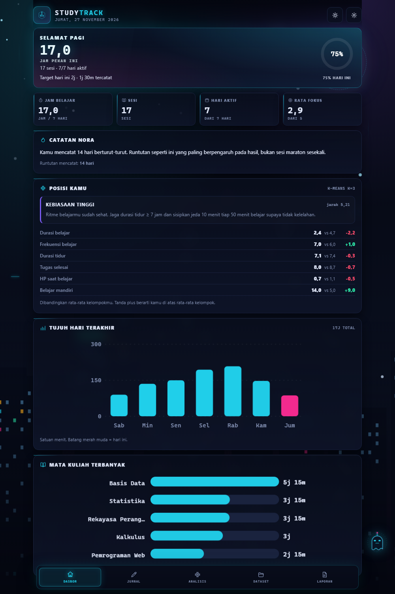 |
| Jurnal | 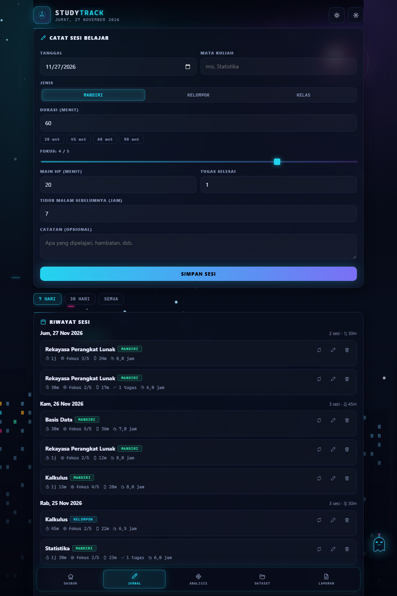 |
| Analisis | 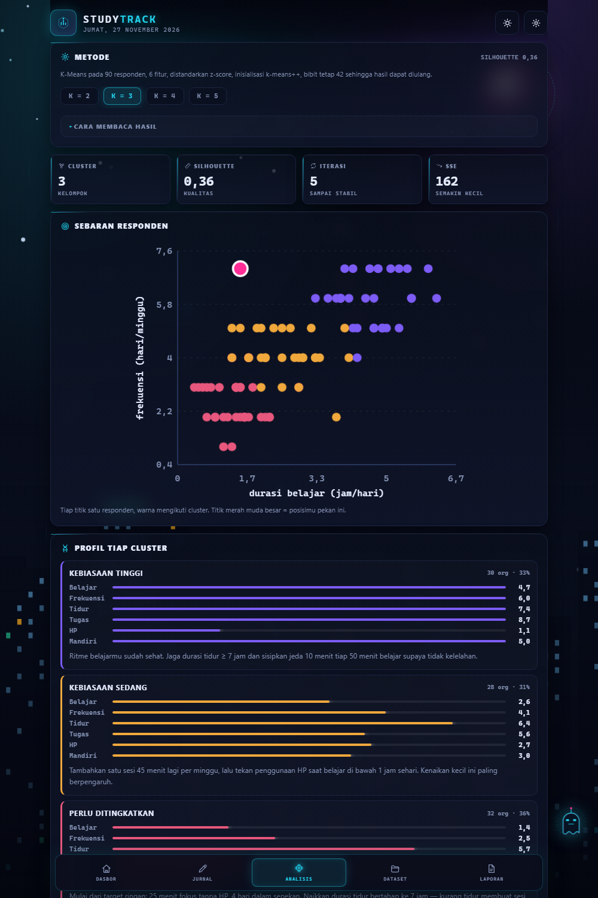 |
| Dataset | 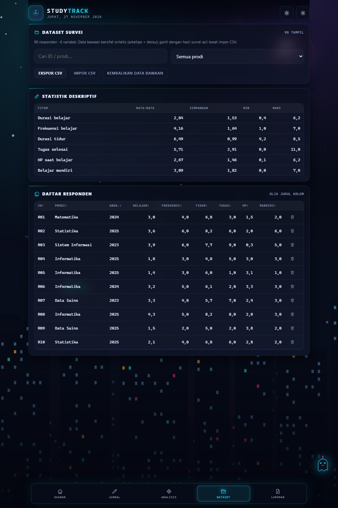 |
| Laporan | 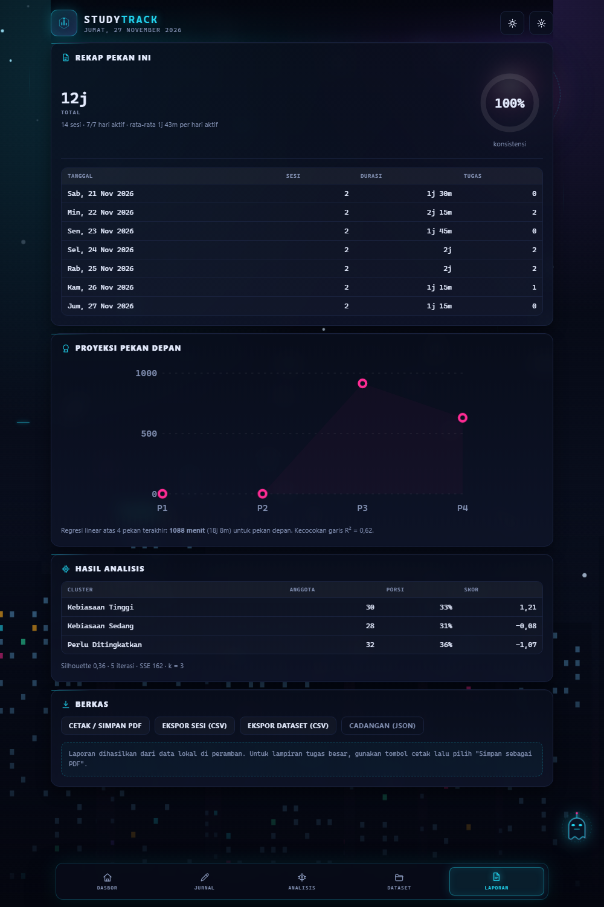 |

| Layar | Tangkapan |
|-------|-----------|
| Pengaturan (lembar bawah) | 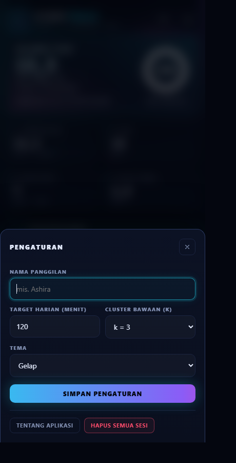 |
| Panduan awal | 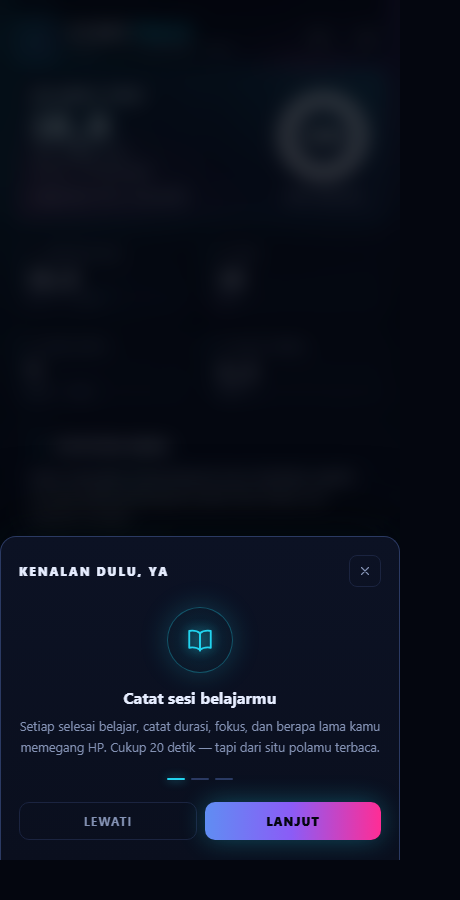 |
| Saran Nora | 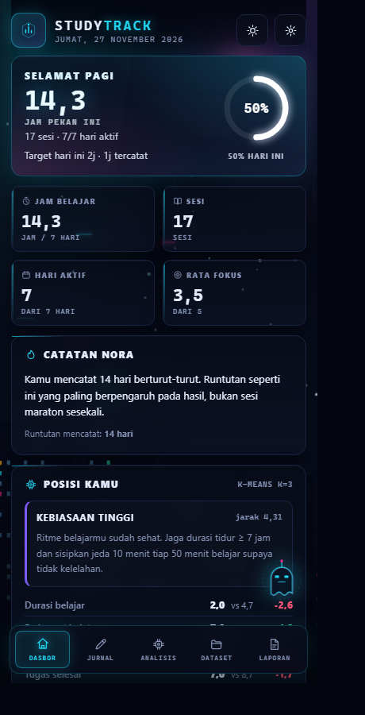 |
| Seluler 400 px | 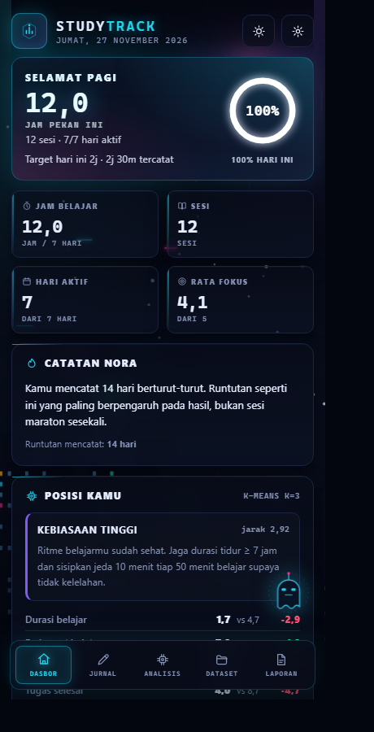 |
| Tema siang | 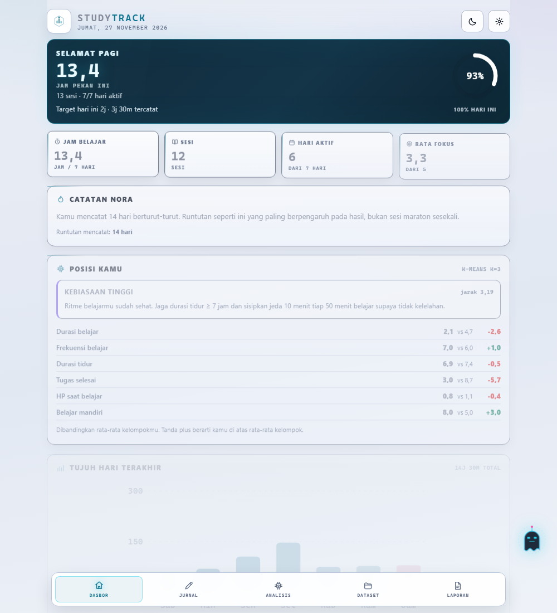 |

### 4.6 Aksesibilitas

| Aspek | Ketetapan | Alasan |
|-------|-----------|--------|
| Kontras teks | ≥ 4,5:1 untuk teks normal, ≥ 3:1 untuk teks besar | Batas WCAG 2.1 AA |
| Target sentuh | ≥ 44 × 44 px | Jari, bukan kursor |
| Fokus papan ketik | Cincin fokus 2 px pada semua kontrol | Aplikasi tetap dapat dipakai tanpa tetikus |
| Gerak | Semua animasi berhenti pada `prefers-reduced-motion` | Pengguna dengan sensitivitas gerak |
| Warna | Status tidak pernah dibedakan **hanya** dengan warna; selalu disertai label | Buta warna merah-hijau |
| Struktur | `role`, `aria-label`, `aria-live` pada gelembung saran | Pembaca layar |

---

## 5. Teknologi yang digunakan

### 5.1 Tabel teknologi

| Lapisan | Teknologi | Versi | Alasan dipilih | Alternatif yang ditolak |
|---------|-----------|-------|----------------|-------------------------|
| Markup | HTML5 | — | Semantik, tanpa lapisan tambahan | — |
| Gaya | CSS3 (custom properties, grid, keyframes) | — | Token warna memungkinkan dua tema dari satu berkas | Tailwind: menambah proses build |
| Antarmuka | JavaScript ES2020 (vanilla) | — | Tanpa build, tanpa `node_modules`; dapat dibuka langsung dari `file://` | React/Vue: 40–130 KB hanya untuk lima tab |
| Grafik | SVG yang dibangun sendiri (`grafik.js`) | — | Kendali penuh atas animasi per elemen; tanpa dependensi | Chart.js: 200 KB, animasi tidak dapat disesuaikan per batang |
| Data Sains | JavaScript murni (`kmeans.js`) | — | Berjalan di peramban tanpa server; dapat diuji di Node | scikit-learn: butuh Python di sisi pengguna |
| Penyimpanan (sekarang) | `localStorage` | — | Nol konfigurasi, bekerja luring, cukup untuk satu pengguna | IndexedDB: berlebihan untuk < 5 MB data |
| Penyimpanan (target) | SQLite → PostgreSQL | — | SQLite cukup untuk satu kelas; PostgreSQL untuk banyak pengguna | — |
| Backend (target) | Flask 3 + SQLAlchemy | — | Ringan, cocok untuk REST API kecil; ekosistem Python menyatu dengan scikit-learn | Django: terlalu besar untuk 11 endpoint |
| Data Sains (target) | scikit-learn + joblib | 1.4 | `KMeans` teruji, `silhouette_score` standar; model diserialisasi | Implementasi sendiri di server: menduplikasi yang sudah ada |
| PWA | Service worker + manifest | — | Dapat dipasang, tetap terbuka saat jaringan putus | — |
| Pengujian | `node:test` | 20+ | Bawaan Node, tanpa dependensi | Jest: 30 MB `node_modules` |
| Versi | Git + GitHub | — | Ketentuan spesifikasi; riwayat commit sebagai bukti kontribusi | — |
| Publikasi | GitHub Pages | — | Statis, gratis, HTTPS otomatis | — |

### 5.2 Mengapa tanpa kerangka kerja

Ini keputusan yang paling sering ditanyakan, jadi perlu dijawab dengan angka, bukan selera:

| Pertimbangan | Tanpa kerangka | Dengan React |
|--------------|----------------|--------------|
| Ukuran muat awal | **148 KB** | ± 290 KB (React + ReactDOM + bundler runtime) |
| Waktu build | tidak ada | perlu langkah bundling |
| Dapat dibuka dari `file://` | ya | tidak (butuh server) |
| Waktu analisis K-Means | **≈ 11 ms** | sama (murni JS) |
| Jumlah dependensi | 0 | 1.200+ paket transitif |

Aplikasi ini punya lima tab dan satu komponen berat (K-Means). Kerangka kerja memberi keuntungan pada
aplikasi dengan puluhan komponen yang saling bertukar state. Di sini, keuntungan itu tidak muncul,
sementara biayanya (ukuran, build, dependensi) langsung terasa. Yang diambil dari ide kerangka kerja
adalah **polanya**, bukan pustakanya: tampilan sebagai fungsi state (`render()`), komponen sebagai
fungsi yang mengembalikan string, dan satu sumber kebenaran.

---

## 6. Rancangan integrasi aplikasi dan komponen Data Sains

### 6.1 Dua mode integrasi

| Mode | Kapan | Letak perhitungan | Kelebihan | Kekurangan |
|------|-------|-------------------|-----------|------------|
| **A — Di peramban** (sekarang) | Satu pengguna, data < 1.000 baris | `kmeans.js` di klien | Nol biaya server, bekerja luring, hasil instan | Tidak dapat berbagi model antar perangkat |
| **B — Di server** (target) | Banyak pengguna, data besar | Flask + scikit-learn | Model terpusat, dapat diaudit, dapat dilatih ulang terjadwal | Butuh server dan jaringan |

Keduanya memakai **kontrak data yang sama**, sehingga perpindahan dari A ke B tidak mengubah lapisan
tampilan.

### 6.2 Alur integrasi mode A

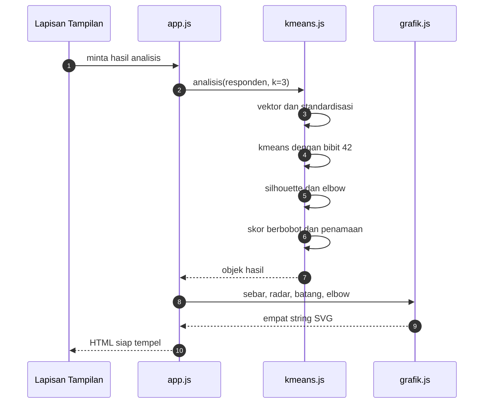

### 6.3 Kontrak data

Masukan dan keluaran ditetapkan sebagai struktur tetap, sehingga mode A dan mode B dapat saling
menggantikan tanpa mengubah pemanggil.

**Masukan** — array objek, enam kunci wajib:

```json
[
  { "id": "R01", "prodi": "Statistika", "angkatan": 2023,
    "durasi": 4.2, "frekuensi": 5, "tidur": 7.1,
    "tugas": 8, "hp": 2.0, "mandiri": 4 }
]
```

**Keluaran** — objek tunggal:

```json
{
  "k": 3,
  "model": { "centroid": [[...]], "label": [0,1,2], "sse": 162.4, "iterasi": 5 },
  "profil": [
    { "cluster": 0, "jumlah": 30, "persen": 33.3, "skor": 1.209,
      "nama": "Kebiasaan Tinggi", "warna": "#2ee6a8",
      "rata": { "durasi": 4.66, "frekuensi": 5.97, "tidur": 7.41,
                "tugas": 8.73, "hp": 1.12, "mandiri": 5.0 } }
  ],
  "silhouette": 0.3551,
  "elbow": [ { "k": 2, "sse": 230 }, { "k": 3, "sse": 162 } ]
}
```

**Aturan kontrak.** Tujuh kunci pada `profil[].rata` harus selalu ada, meskipun nilainya nol. Ini
mencegah grafik radar menggambar poligon cacat ketika satu fitur kosong. Nilai `silhouette` dan `sse`
wajib disertakan agar tampilan dapat menyatakan mutu hasil, bukan hanya menampilkannya.

### 6.4 Titik integrasi di kode

| Titik | Fungsi | Arah data |
|-------|--------|-----------|
| P1 | `fiturPengguna()` → `K.tempatkan()` | sesi pengguna → vektor |
| P2 | `dataset` → `K.analisis()` | 90 baris → model |
| P3 | `K.analisis()` → `Grafik.*()` | model → empat SVG |
| P4 | `K.analisis()` → `wawasan()` | profil → saran |
| P5 | `K.regresi()` → `Grafik.garis()` | rekap pekan → proyeksi |

Kelima titik ini adalah **satu-satunya** tempat lapisan tampilan menyentuh Data Sains. Tidak ada
perhitungan statistik yang ditulis ulang di `app.js` — aturan yang menjaga agar angka di layar selalu
berasal dari satu implementasi.

### 6.5 Mode B — rancangan API

| Metode | Rute | Masukan | Keluaran |
|--------|------|---------|----------|
| `POST` | `/api/analisis` | `{ k, dataset_id }` | objek hasil (kontrak §6.3) |
| `GET` | `/api/analisis/<id>` | — | hasil tersimpan dari tabel `analisis` |
| `POST` | `/api/penempatan` | `{ analisis_id, sesi[] }` | `{ label, jarak, profil }` |
| `POST` | `/api/dataset` | berkas CSV | `{ dataset_id, jumlah_baris }` |
| `GET` | `/api/rekap` | `?dari=&sampai=` | rekap pekan (view `v_rekap_pekan`) |

**Rancangan penanganan galat.** Setiap rute mengembalikan bentuk galat yang sama:

```json
{ "galat": "header_kurang", "pesan": "Kolom wajib tidak ditemukan: tugas, mandiri",
  "detail": { "hilang": ["tugas", "mandiri"] } }
```

Kode `galat` bersifat mesin (dipakai tampilan), `pesan` bersifat manusia (ditampilkan apa adanya), dan
`detail` memungkinkan tampilan menandai kolom yang salah. Pemisahan ini mencegah tampilan harus
menebak-nebak dari teks pesan.

### 6.6 Pengujian integrasi

| Yang diuji | Cara | Ambang |
|------------|------|--------|
| Determinisme | Jalankan `analisis()` dua kali pada data sama | Label identik |
| Kesetaraan mode A dan B | Bandingkan `silhouette` dan `sse` JS vs scikit-learn | Selisih < 1e-6 |
| Kebal data ekstrem | Dataset dengan satu outlier 24 jam | Tidak ada `NaN`, tidak ada centroid kosong |
| Kualitas cluster | `silhouette` pada dataset acuan | > 0,25 |
| Kinerja | 90 baris, k = 3 | < 100 ms |

Butir kedua adalah syarat terpenting bila mode B dipakai: bila implementasi JS dan scikit-learn
memberi hasil berbeda, pengguna akan melihat angka berubah hanya karena berpindah perangkat.

---

## 7. Keterbatasan rancangan yang diakui

1. **Basis data belum terpasang.** Skema pada §3.4 sudah lengkap dan siap dijalankan, tetapi versi web
   masih memakai `localStorage`. Bab IV laporan menyebut hal ini apa adanya.
2. **Autentikasi dan peran belum ditegakkan.** Tabel `pengguna` sudah menyiapkan kolom `peran`, tetapi
   belum ada mekanisme masuk.
3. **Rancangan antarmuka untuk peran dosen belum dibuat.** Versi sekarang hanya untuk mahasiswa.
4. **Mode B belum diimplementasikan.** API pada §6.5 masih rancangan.

Keempat butir ini adalah pekerjaan Tahap 5, bukan cacat perancangan. Yang penting, jalur peningkatannya
sudah disiapkan: `Penyimpanan` sebagai satu titik ganti, kontrak data yang tetap, dan skema basis data
yang sudah dinormalisasi.

---

## 8. Riwayat dokumen

| Tanggal | Versi | Perubahan |
|---------|-------|-----------|
| 27 November 2026 | v1.0 | Dokumen perancangan arsitektur, basis data, antarmuka, teknologi, dan integrasi Data Sains disusun |
